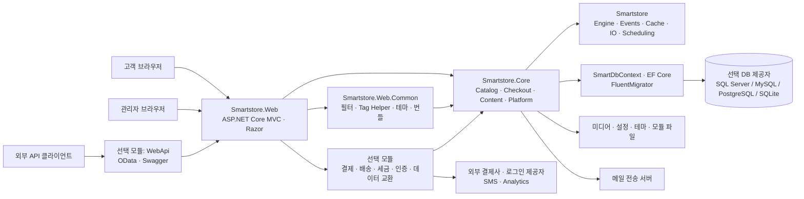
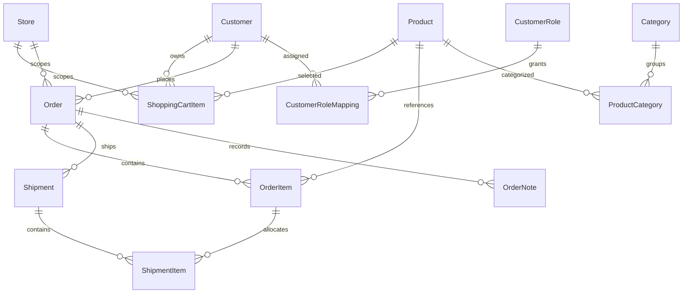

# Smartstore AS-IS 시스템 분석서

Smartstore의 현재 소스와 저장소 개발 문서를 기준으로 고객 화면과 구매 흐름을 중심으로 시스템 구조, 기능, 데이터, 업무 흐름과 운영 경계를 정리한다. 개선 설계나 신규 기능 제안은 포함하지 않는다.

## 1. 분석 범위와 기준선

| 항목 | 기준 |
| --- | --- |
| 조사일 | 2026-11-07, Asia/Seoul |
| 기준 커밋 | `a19657d6ed1394c1f74afa8d198166ef49347267` |
| 커밋 설명 | Refine dashboard grid resizing and drag behavior and group widget selection by module |
| 조사 시작 작업 트리 | `git status --short` 기준 변경 없음 |
| 제품 버전·대상 프레임워크 | 저장소 설정 `6.4.0.0`, `net10.0` |
| 사용자 확정 중점 | 고객 화면과 구매 흐름 중심 |
| 상세 대상 | 고객 frontend 전체의 소스 페이지·주요 장면, 회원·상품 탐색·장바구니·checkout·결제·주문 후 처리 |
| 연결 맥락 | 관리자 backend의 운영 책임, 공통 라이브러리, 도메인·데이터 계층, 17개 소스 모듈, 빌드·테스트·배포 |
| 상세 UI 제외 | 관리자·설치·Entity 관리 도구, 비공개/미설치 추가 모듈, 외부 제공자 화면 |
| 관찰 방법 | 개발 문서, 프로젝트 참조, 부트스트랩, 라우트·컨트롤러, 메뉴, Razor·폼·스크립트, 서비스 계약·구현, 데이터 모델 정적 조사 |
| 실행 환경 | 조사 셸에서 `dotnet` 실행 파일을 찾지 못함. 실행 중인 제품 URL·설치 DB·외부 서비스 계정은 제공되지 않음 |

**이 문서는 코드 기준 시스템 분석서다. 운영 인스턴스의 설치 모듈·설정·데이터·화면을 실측한 문서가 아니다.** 아래에서 “확인”은 별도 표시가 없으면 소스에서의 확인을 뜻한다. 조건부 동작은 배포 설정과 사용자 권한에 따라 달라진다.

- **확인:** 구현 또는 개발 문서에서 경로·계약을 식별했다.
- **추론:** 정적 의존·호출 관계에서 구조를 해석했다. 운영 사실로 확정하지 않는다.
- **미확인:** 실행·배포 자료 또는 외부 시스템 응답이 필요한 항목이다.

개발 문서가 권위 있는 설명 출발점이지만 현 코드 및 저장소 규칙과 충돌하는 문장은 그대로 옮기지 않았다. 예를 들어 `architecture-overview.md`의 EF migration·빌드 시 자산 처리 설명은 각각 FluentMigrator와 요청 시 동적 번들 처리 구현으로 보정했다. 원본 문서는 변경하지 않았다.

### 산출물 안내

| 문서 | 내용 |
| --- | --- |
| [본 분석서](system-design-as-is.md) | 구조, 용어, 기능, 데이터, 운영, 근거, 검증·미확인 기록 |
| [화면 이동](navigation.md) | 시나리오 색인, 분기·복귀, 실제 작업 진입점 목록 |
| [화면 배치](screen-layout.md) | 전체 Razor 조사 목록, 페이지·팝업·출력 구분, 배치 및 HTML 대응 |
| [매크로 업무 흐름](details/job-flow/macro.md) | 시스템과 고객·운영자·외부 제공자 간 메시지 |
| [Smartstore.Web 내부 흐름](details/job-flow/smartstore-web.md) | 실행 호스트 내부의 부트스트랩·로그인·장바구니·주문·운영 흐름 |

하나의 제품 웹 호스트를 확인했으므로 독립 내부 서비스 간 협력을 가정한 `details/job-flow/system.md`는 만들지 않았다. DB, 결제사, SMTP는 인프라·외부 연동 경계다. 선택 모듈은 별도 배포 서비스가 아니라 호스트에 로드되는 확장이다.

## 2. 시스템 구조

### 실행 구성

그림은 실행 책임과 주요 호출·접근을 요약한다. 모든 선이 프로젝트의 직접 정적 참조라는 뜻은 아니다. **모듈형 단일 애플리케이션**이라는 해석은 하나의 `Program.cs`, 공통 DI 컨테이너·컨텍스트, 동적 모듈 로딩에 근거한다. 운영 인스턴스 수, 프록시, 컨테이너 오케스트레이터는 미확인이다.

### 소스 책임과 변경 경계

| 소스 | 현재 책임 | 연결 근거 |
| --- | --- | --- |
| `src/Smartstore` | 엔진, 모듈 기술 기반, 이벤트, 캐시, IO, 데이터 확장, 스케줄링, 유틸리티 | `Engine/EngineStarter.cs`, `Events/EventPublisher.cs` |
| `src/Smartstore.Core` | 상품·주문·회원·콘텐츠 등 도메인과 서비스, `SmartDbContext`, 마이그레이션, 설치·설정 | `CoreStarter.cs`, 도메인별 `SmartDbContext.*.cs` |
| `src/Smartstore.Web.Common` | MVC 구성·가드, 공통 컨트롤러, Razor 도구, 테마와 동적 자산 | `WebStarter.cs`, `MvcStarter.cs` |
| `src/Smartstore.Web` | 실행 호스트, 고객·관리자 컨트롤러·뷰·모델, 테마, seed 데이터 | `Program.cs`, `Controllers`, `Areas/Admin` |
| `src/Smartstore.Data/*` | 4개 DB 제공자별 팩토리·SQL·매핑 지원 | 제공자별 `.csproj` 및 구현 |
| `src/Smartstore.Modules/*` | 선택 기능의 실제 소스, 구성 UI, locale, 자산 | 각 `module.json`, `Module.cs`, `Startup.cs` |
| `src/Smartstore.Build` | 공통 프레임워크·버전·빌드 설정, Nuke, 모듈 빌더 | `Smartstore.Common.props`, `Smartstore.Build/Build.cs` |
| `test` | 기본·코어·웹·공통 테스트 프로젝트 | `Smartstore.Tests`, `Smartstore.Core.Tests`, `Smartstore.Web.Tests`, `Smartstore.Test.Common` |
| `tools` | 패키징·API 클라이언트 등 별도 도구 | `Smartstore.Tools.sln` |

`src/Smartstore.Web/Modules/`는 컴파일 결과와 복사된 뷰·자산이므로 분석 원본·수정 대상으로 사용하지 않았다. 개발 시 모듈 파일 제공자는 `ModuleDescriptor.SourcePhysicalPath`로 소스 또는 해석된 심볼릭 링크 대상을 사용할 수 있다. 소스 존재, 빌드 출력 존재, 실제 설치·활성화 여부는 서로 다른 사실이다.

### 기동과 HTTP 요청

1. `Program.cs`가 ASP.NET Core 빌더를 만들고 `Config/connections*.json`, `Config/usersettings*.json`을 추가한다. 환경별 파일의 적용 순서는 코드가 정한다.
2. Serilog, Autofac 서비스 제공자, `SmartApplicationContext`, 엔진을 구성한다. `IStarter` 구현들이 서비스·컨테이너·MVC·라우트·파이프라인 구성에 참여한다.
3. 설치 상태이면 `IDatabaseInitializer.InitializeDatabasesAsync`를 실행한다. 이후 파이프라인을 조립하고 호스트를 시작한다.
4. 웹 파이프라인이 프록시 헤더, 오류 처리, 현지화 라우팅, 작업 컨텍스트, 세션과 checkout 상태 등을 구성한다. 인증·권한 및 설치 여부에 따른 구성은 각 Starter와 필터가 맡는다.
5. MVC가 컨트롤러·모델 검증·서비스를 실행하고 Razor 또는 JSON·파일·리다이렉트 결과를 반환한다. 고객 컨트롤러에는 자동 저장 필터가 적용되지만 모든 액션이 자동 저장에 의존하는 것은 아니다. checkout 완료는 명시적으로 자동 저장을 끄고 자체 처리를 실행한다.

근거: [Program.cs](../../../../src/Smartstore.Web/Program.cs), [EngineStarter.cs](../../../../src/Smartstore/Engine/EngineStarter.cs), [WebStarter.cs](../../../../src/Smartstore.Web.Common/WebStarter.cs), [MvcStarter.cs](../../../../src/Smartstore.Web.Common/MvcStarter.cs), [CoreStarter.cs](../../../../src/Smartstore.Core/CoreStarter.cs).

### 라우팅과 접근 제어

| 경계 | 확인한 계약 |
| --- | --- |
| 관리자 | `{area:exists}/{controller=Home}/{action=Index}/{id?}`. `AdminController`의 Area, anti-forgery, 관리자 권한, 관리자 IP 필터 적용 |
| 일반 MVC | 현지화된 `{controller=Home}/{action=Index}/{id?}`와 액션별 `LocalizedRoute` 병행 |
| 상품·카테고리·브랜드·Topic | SEO slug 변환과 DB의 URL 레코드, 선택 템플릿에 따라 실제 뷰 해석 |
| 고객 공통 가드 | `PublicController`: 쿠키 동의, preview, 매장 닫힘, shop 접근 권한, 활동·affiliate 추적, 저장 필터 |
| 액션 권한 | `PermissionAttribute` 및 `IPermissionService`; 메뉴 가시성과 서버 권한 검증을 구분 |
| 엔티티 노출 | 역할 기반 ACL, 매장 제한, 게시 상태, 소유권 등 기능별 조건 적용 |
| API | WebApi 모듈 설치·활성화 시 OData 경로와 attribute routing. public/secret key를 사용하는 Basic 인증 |

관리자 메뉴의 원본은 `Areas/Admin/sitemap.xml`, 설정 메뉴는 `SettingsMenu`, 회원 메뉴는 `MyAccountMenu`다. 모듈은 메뉴 이벤트에 참여할 수 있으므로 XML 메뉴만으로 UI 전체를 판정할 수 없다. 직접 URL, 탭·행 명령, 모달·팝업도 [화면 이동 문서](navigation.md)에 연결한다.

근거: [AdminController](../../../../src/Smartstore.Web.Common/Controllers/AdminController.cs), [PublicController](../../../../src/Smartstore.Web.Common/Controllers/PublicController.cs), [보안 문서](../../../../dev-docs/framework/platform/security.md), [관리자 메뉴](../../../../src/Smartstore.Web/Areas/Admin/Infrastructure/Menus/AdminMenu.cs), [설정 메뉴](../../../../src/Smartstore.Web/Areas/Admin/Infrastructure/Menus/SettingsMenu.cs), [회원 메뉴](../../../../src/Smartstore.Web/Infrastructure/Menus/MyAccountMenu.cs).

## 3. 핵심 용어

| 용어 | 현재 의미 |
| --- | --- |
| frontend / backend | 고객 쇼핑 화면 / 관리자 운영 화면 |
| Store | 같은 애플리케이션에서 설정·노출을 구분하는 매장 단위 |
| WorkContext / StoreContext | 현재 고객·언어·통화·관리자 여부 / 현재 매장 등 요청 맥락 |
| Customer | 회원뿐 아니라 게스트·시스템 계정을 포함하는 고객 엔티티 |
| Product | 상품. 단일·그룹·번들, 속성·조합·가격·재고 등과 연결 |
| ShoppingCartItem | 고객·매장·cart type에 속하는 DB 저장 항목. wishlist도 같은 기반 사용 |
| CheckoutState | 세션에 보관하는 결제 진행 상태. 장바구니 DB와 수명이 다름 |
| CheckoutHandler / CheckoutStep | 주문 단계의 처리 계약 / 순서·라우트·뷰와 처리기를 연결하는 단계 |
| Order / PaymentStatus / ShippingStatus | 주문 및 별도로 관리하는 결제·배송 상태. 주문 생성이 결제·배송 완료를 뜻하지 않음 |
| Provider | 결제·배송·세금·인증·export 등 교체 가능한 기능 계약의 구현 |
| Module | 메타데이터·어셈블리·Startup·뷰·자산·locale을 가진 선택 확장 |
| Widget zone | 모듈·컴포넌트가 콘텐츠를 렌더링하는 확장 위치 |
| Topic | 일반 콘텐츠 문서. 게시·매장·ACL·암호 등 조건을 가질 수 있음 |
| LocaleStringResource / LocalizedProperty | UI 문자열 번역 / 엔티티별 다국어 속성 |
| RuleSet | 장바구니·고객 등 조건을 판정하는 규칙 집합 |
| QueuedEmail | 발송 대기·결과·재시도 정보를 보관하는 이메일 데이터 |
| TaskDescriptor | 예약 작업의 설정·스케줄·실행 정보를 연결하는 영속 모델 |
| DataSeeder / FluentMigrator | 초기·기준 데이터 반영 / DB 스키마 버전 변경의 도구 |

## 4. 기능 목록

각 기능을 실제 진입점 및 [시나리오 상세](navigation.md)에 연결한다. 생성·수정·삭제·선택 등 작업 메서드는 [전체 작업 진입점](navigation.md#action-inventory)에 보존한다.

| 기능 | 실제 진입점·소유 영역 | 사용자 과업·현재 결과 | 상세 시나리오 |
| --- | --- | --- | --- |
| 홈·문의 | `HomeController` | 홈·매장 닫힘·문의 제출·결과 | [N01–N02](navigation.md#n01) |
| 인증·계정 | `IdentityController` | 로그인·로그아웃·가입·활성화·비밀번호·외부 로그인 | [N03–N09](navigation.md#n03), [N51](navigation.md#n51) |
| 상품 탐색 | `CatalogController·SearchController` | 검색·즉시 검색·카테고리·브랜드·태그·신상품·최근 본 상품 | [N10–N12](navigation.md#n10) |
| 상품 상세·고객 상호작용 | `ProductController` | 옵션·조합·후기·문의·추천메일·재입고 구독 | [N13–N17](navigation.md#n13) |
| 장바구니 | `ShoppingCartController` | 담기·수량·삭제·계속 쇼핑 | [N18–N19](navigation.md#n18) |
| 주문 금액·속성 | `ShoppingCartController` | 할인코드·기프트카드·포인트·배송비·파일 속성 | [N20–N24](navigation.md#n20) |
| 위시리스트·비교 | `ShoppingCartController·CatalogController` | 공유·이동·비교 담기/제거·패널 | [N25–N26](navigation.md#n25) |
| 구매 진입·주소 | `CheckoutController·ICheckoutWorkflow` | 회원/게스트·청구주소·배송주소 | [N27–N29](navigation.md#n27) |
| 배송·결제 선택 | `CheckoutWorkflow·handlers` | 단계 skip·선택·provider 입력·AJAX 갱신 | [N30–N31](navigation.md#n30) |
| 주문 확정·결제 복귀 | `CheckoutController·IOrderProcessingService·payment provider` | 동의·외부 확인·주문 저장·복귀·기존 주문 복구·완료 | [N32–N34](navigation.md#n32) |
| 회원 정보·주소·이미지 | `CustomerController` | 내 정보·주소 CRUD·기본주소·avatar | [N35–N37](navigation.md#n35) |
| 주문·배송·출력 | `CustomerController·OrderController` | 내 주문·정기결제 취소·상세·추적·HTML/PDF·재주문·재결제 | [N38–N43](navigation.md#n38) |
| 반품·구매 파일 | `ReturnCaseController·DownloadController` | 반품 신청·내 반품·상품 다운로드·라이선스·약관 | [N44–N45](navigation.md#n44) |
| 포인트·알림 관리 | `CustomerController` | 보유 포인트·이력 조회·재입고 구독 해제 | [N46](navigation.md#n46) |
| 콘텐츠·뉴스레터·공통 셸 | `TopicController·NewsletterController·CommonController·MenuController` | 암호 콘텐츠·구독 확인·메뉴·쿠키 동의·언어·통화 | [N47–N49](navigation.md#n47) |
| 실패와 접근 제한 | `ErrorController·상속 가드` | HTML·AJAX·JSON 오류·인증 및 권한 분기 | [N50](navigation.md#n50) |

관리자 상품·고객·주문·배송·환불·재고·콘텐츠·설정·모듈·예약작업은 위 고객 과업의 데이터를 운영한다. 해당 소스와 책임은 구조·데이터 절에서 설명하되, 사용자 지정 중점에 따라 관리자 화면별 Layout·HTML·상세 Navigation은 작성 대상에서 제외했다. 설치 UI도 호스트 기동 맥락만 기록한다.

### 선택 모듈

아래 목록은 소스 포함 여부다. 운영 설치·활성화 여부는 미확인이다. 모듈 이름은 실제 폴더·`SystemName`을 따른다.

| 모듈 | 소스 그룹·역할 | 구매 흐름 연결 |
| --- | --- | --- |
| [Smartstore.AmazonPay](../../../../src/Smartstore.Modules/Smartstore.AmazonPay/module.json) | Payment · Login and Pay with Amazon | 결제 선택·확인·재결제 |
| [Smartstore.Apple.Auth](../../../../src/Smartstore.Modules/Smartstore.Apple.Auth/module.json) | Security · Enables login with Apple account. | 외부 로그인 |
| [Smartstore.Clickatell](../../../../src/Smartstore.Modules/Smartstore.Clickatell/module.json) | Mobile · Sends order notifications to shop administrator via SMS. | 외부 연동·운영 확장 |
| [Smartstore.DevTools](../../../../src/Smartstore.Modules/Smartstore.DevTools/module.json) | Developer · Smartstore Developer Tools (MiniProfiler and other goodies) | 외부 연동·운영 확장 |
| [Smartstore.Facebook.Auth](../../../../src/Smartstore.Modules/Smartstore.Facebook.Auth/module.json) | Security · Enables login with Facebook account. | 외부 로그인 |
| [Smartstore.Google.Analytics](../../../../src/Smartstore.Modules/Smartstore.Google.Analytics/module.json) | Analytics · Adds Google Analytics tracking scripts to the shop. | 외부 연동·운영 확장 |
| [Smartstore.Google.Auth](../../../../src/Smartstore.Modules/Smartstore.Google.Auth/module.json) | Security · Enables login with Google account. | 외부 로그인 |
| [Smartstore.Google.MerchantCenter](../../../../src/Smartstore.Modules/Smartstore.Google.MerchantCenter/module.json) | Marketing · Exports products in the Google Merchant Center feed format. | 외부 연동·운영 확장 |
| [Smartstore.Microsoft.Auth](../../../../src/Smartstore.Modules/Smartstore.Microsoft.Auth/module.json) | Security · Enables login with Microsoft account. | 외부 로그인 |
| [Smartstore.OfflinePayment](../../../../src/Smartstore.Modules/Smartstore.OfflinePayment/module.json) | Payment · Adds offline payment methods to the store | 결제 선택·확인·재결제 |
| [Smartstore.PayPal](../../../../src/Smartstore.Modules/Smartstore.PayPal/module.json) | Payment · Enables payments with PayPal | 결제 선택·확인·재결제 |
| [Smartstore.Shipping](../../../../src/Smartstore.Modules/Smartstore.Shipping/module.json) | Shipping · Provides shipping methods for fixed rate shipping and computation based on total. | 배송 후보·요금 |
| [Smartstore.ShippingByWeight](../../../../src/Smartstore.Modules/Smartstore.ShippingByWeight/module.json) | Shipping · Provides shipping methods with computation based on weight. | 배송 후보·요금 |
| [Smartstore.Stripe](../../../../src/Smartstore.Modules/Smartstore.Stripe/module.json) | Payment · Extends the store with Stripe payment. | 결제 선택·확인·재결제 |
| [Smartstore.Tax](../../../../src/Smartstore.Modules/Smartstore.Tax/module.json) | Tax · Contains default tax providers like FixedRate & ByRegion | 세액 계산 |
| [Smartstore.Twitter.Auth](../../../../src/Smartstore.Modules/Smartstore.Twitter.Auth/module.json) | Security · Enables login with X account. | 외부 로그인 |
| [Smartstore.WebApi](../../../../src/Smartstore.Modules/Smartstore.WebApi/module.json) | Developer · Provides RESTful data exchange with Smartstore based on OData | 외부 연동·운영 확장 |

## 5. 데이터 구조와 상태 소유권

### 주요 영속 데이터

`SmartDbContext`는 `HookingDbContext`를 상속한다. 도메인별 partial 파일의 `DbSet`과 EF 모델·설정이 공통 컨텍스트를 확장한다. 조회·저장은 서비스뿐 아니라 컨트롤러에도 존재한다. 모든 접근이 별도 repository 또는 순수 도메인 계층을 경유한다고 설명할 근거는 없다.

| 업무 영역 | 주요 엔티티 | 상태·쓰기 책임과 유의점 |
| --- | --- | --- |
| 회원·주소 | Customer, CustomerRole, CustomerRoleMapping, Address, ExternalAuthenticationRecord | Identity 관리자·고객 서비스와 컨트롤러. 요청 고객과 대상 소유권을 별도 확인 |
| 상품 | Product, Category, Manufacturer, ProductCategory, ProductManufacturer, ProductMediaFile | 상품·분류 서비스 및 관리자 편집. 게시·매장·ACL·상품 타입별 조건 |
| 상품 옵션·가격 | ProductVariantAttribute, ProductVariantAttributeValue, ProductVariantAttributeCombination, TierPrice, Discount | 속성·재고·가격 서비스와 관리자 작업. 옵션 조합과 수량·가격 재검증 |
| 장바구니 | ShoppingCartItem, CheckoutAttribute, CheckoutAttributeValue | `IShoppingCartService`. 고객·매장·cart type별 영속, 변경 시 checkout 데이터 무효화 가능 |
| 주문·판매 | Order, OrderItem, OrderNote, RecurringPayment, GiftCardUsageHistory | `IOrderProcessingService` 및 운영 컨트롤러. 결제·배송 상태와 주문 상태 분리 |
| 물류·반품 | Shipment, ShipmentItem, ShippingMethod, ReturnCase | 배송·반품 서비스, 사용자·관리자 처리. 부분 출고·반품 가능 조건 |
| 설정·매장·언어 | Setting, Store, StoreMapping, Language, LocaleStringResource, LocalizedProperty | 매장·설정·현지화 서비스. 전역 값과 매장별 override 구분 |
| 콘텐츠·미디어 | Topic, Menu 관련 엔티티, MediaFile·폴더, Download | 콘텐츠·메뉴·미디어 서비스. DB 메타데이터와 저장 파일·외부 URL 구분 |
| 권한·URL | PermissionRecord, PermissionRoleMapping, AclRecord, UrlRecord | 권한·ACL·SEO 서비스. 메뉴 숨김이 서버 권한 보장을 대신하지 않음 |
| 메시지·운영 | MessageTemplate, EmailAccount, QueuedEmail, TaskDescriptor, TaskExecutionInfo, Log·ActivityLog | 메시지 큐 서비스·작업 스케줄러·로깅. 접수·실행·성공을 구분 |

근거: [SmartDbContext](../../../../src/Smartstore.Core/Data/SmartDbContext.cs), [상품 DbSet](../../../../src/Smartstore.Core/Catalog/SmartDbContext.Catalog.cs), [주문 DbSet](../../../../src/Smartstore.Core/Checkout/SmartDbContext.Checkout.cs), [회원 DbSet](../../../../src/Smartstore.Core/Platform/Identity/SmartDbContext.Customers.cs), [데이터 접근 문서](../../../../dev-docs/getting-started/data-access.md).

이 ER 그림은 주요 객체의 관계 요약이다. 전체 물리 스키마·FK nullability·삭제 규칙·모든 속성을 표현한 ERD가 아니다. 실제 스키마 버전과 데이터 규모는 DB를 조회하지 않아 미확인이다.

### 장바구니·checkout·주문의 수명

| 상태 | 저장 위치 | 확인한 전환 |
| --- | --- | --- |
| 게스트·회원 식별 | Identity·요청 맥락 및 영속 고객 | 로그인 성공 시 게스트 cart를 회원 cart로 이관 |
| Cart / Wishlist | DB `ShoppingCartItem`, 요청 내 캐시 | 수량·삭제·이동·상품 검증, 설정에 따라 checkout 선택 초기화 |
| CheckoutState | ASP.NET Core 세션 키 `.Smart.CheckoutState` | 지연 로딩, 변경 추적, 저장·Abandon. 외부 결제 복귀 시 쿠키·세션 연속성에 영향받음 |
| 주문 | DB `Order` 및 관련 데이터 | 검증 후 결제 처리·저장·상태 확인, 커밋 후 메시지와 이벤트 |
| 결제 복구 정보 | 결제 provider·주문 GUID·복구 데이터 계약 | 복구 시 고객·매장·현재 cart hash 등 검사. 모든 provider의 외부 멱등성 보장을 의미하지 않음 |

근거: [장바구니 문서](../../../../dev-docs/framework/commerce/cart.md), [DefaultCheckoutStateAccessor](../../../../src/Smartstore.Core/Checkout/Orders/Services/DefaultCheckoutStateAccessor.cs), [CheckoutWorkflow](../../../../src/Smartstore.Core/Checkout/Orders/Services/CheckoutWorkflow.cs).

### 주문 확정과 실패 경계

`PlaceOrderAsync`는 사전 검증 후 DB 트랜잭션을 시작하고 고객·가격 정보 적용, `ProcessPayment`, 주문 저장, 항목·관련 데이터 저장, 주문 상태 처리와 커밋을 진행한다. 커밋 후 이메일 생성·발송 경로와 `OrderPlaced`·조건부 `OrderPaid` 이벤트를 실행한다.

- DB 트랜잭션은 DB 변경의 경계다. 외부 결제사의 부작용까지 rollback한다는 보장은 없다.
- 결제 후 주문 저장 실패, 응답 유실, webhook과 브라우저 복귀의 순서 차이는 일반 폼 검증 실패와 다르다. 구현에는 `RecoverOrderAsync`와 `CompletePaymentAsync`의 기존 주문 조회 경로가 있다.
- `CompletePaymentAsync`는 동일 OrderGuid·고객·매장으로 주문이 이미 존재하는 경우 완료 화면으로 갈 수 있다. 이 특정 경로를 시스템 전체의 exactly-once 처리라고 확대 해석하지 않는다.
- 커밋 후 알림 실패가 발생할 수 있는 구조다. 저장·이벤트 발행을 원자적으로 연결하는 영속 outbox 보장은 이 조사에서 확인하지 않았다.
- 복구 주문은 현재 저장된 고객 주소·선택 배송 옵션을 사용할 수 있다. 원래 결제 시 주소와 언제나 동일하다고 단정할 수 없다.

근거: [주문 생성·복구](../../../../src/Smartstore.Core/Checkout/Orders/Services/OrderProcessingService.PlaceOrder.cs), [결제 작업](../../../../src/Smartstore.Core/Checkout/Orders/Services/OrderProcessingService.Payment.cs), [checkout 조율](../../../../src/Smartstore.Core/Checkout/Orders/Services/CheckoutWorkflow.cs). 더 자세한 호출 흐름은 [내부 Job Flow](details/job-flow/smartstore-web.md#order-placement)를 참조한다.

### 스키마 변경과 seed

스키마 변경은 **FluentMigrator**를 사용한다. EF Core migration 생성·적용을 현재 절차로 제시하지 않는다. 모듈별 migration 범위, 버전, 데이터 seed와 schema 변경은 구분한다. 코어 locale은 `SmartDbContextDataSeeder.cs`, 모듈 locale은 해당 모듈 `Localization/resources.*.xml`에 있다. 설치 seed와 demo catalog는 각각 seed README·CATALOG 설명을 따른다.

근거: [DB 마이그레이션 문서](../../../../dev-docs/framework/platform/database-migrations.md), [코어 seeder](../../../../src/Smartstore.Core/Migrations/SmartDbContextDataSeeder.cs), [설치 seed](../../../../src/Smartstore.Web/App_Data/Seed/README.md).

## 6. 공통 처리와 외부 계약

| 항목 | 현재 구현·경계 | 확인되지 않은 운영 값 |
| --- | --- | --- |
| DI | Microsoft DI·Autofac, Starter와 모듈의 등록, scope별 서비스 | 실제 설치 모듈에 따른 최종 컨테이너 |
| 이벤트 | `EventPublisher`가 프로세스 내부 consumer registry를 순회. 일반 async 소비자는 await, 지정된 fire-and-forget은 대기하지 않음 | 장애 재전달·영속성·분산 전달 보장 |
| DB hook | 저장 전후 hook으로 영속 변경 확장 | 모든 모듈의 hook 충돌·수행 비용 |
| 캐시 | 메모리·DB 쿼리 캐시·출력 캐시 등 별도 계층, 설정으로 활성화 | 운영 hit rate·TTL·노드 간 무효화 |
| 예약 작업 | `DefaultTaskScheduler`, DB task store, 작업용 HTTP 요청·상태 | 실제 작업 주기·중복 실행·노드 배치 |
| 이메일 | Liquid 템플릿·메시지 생성, `QueuedEmailService`, 발송 작업과 SMTP | 실제 SMTP·배달·재시도 결과 |
| 검색 | `ICatalogSearchService`, 코어 LINQ 구현 등 확장 지점 | 운영 검색 provider·인덱스·성능 |
| 미디어·PDF | 미디어/파일 추상화, 다운로드 권한, wkhtmltopdf·HTTP 기반 문서 생성 | 설치 native binary·파일 저장소·폰트 |
| 자산 | 요청 시 JS/Sass/CSS 번들 처리, native embedded Dart Sass·Lightning CSS | 배포 시 번들·캐시 설정 및 최종 CSS |
| 테마·widgets | Razor 테마·상속·widget zone·module source file provider | 활성 테마·위젯 구성·추가 상용 모듈 |
| Web API | OData·Swagger, Basic public/secret API key, HTTPS 조건·사용자 활성 검증 | 활성 키·API 권한·외부 호출량 |
| 결제·외부 인증 | Provider별 HTTP/SDK, 리다이렉트·callback·webhook | 각 계정·환경·서명·외부 응답·재전달 정책 |
| AI·Page Builder | 코어 추상화·확장 계약과 통합 지점 | 별도 vendor provider·완전한 편집기의 실제 설치 여부 |

이벤트 버스·스케줄러·모듈이라는 이름만으로 메시지 브로커, 별도 worker 프로세스, 마이크로서비스를 가정하지 않는다. 코어에 Page Builder·AI 계약이 있다는 사실과 동작 가능한 상용 편집기·LLM 제공자가 설치돼 있다는 사실도 구분한다.

근거: [EventPublisher](../../../../src/Smartstore/Events/EventPublisher.cs), [scheduling 문서](../../../../dev-docs/framework/platform/scheduling.md), [캐시 문서](../../../../dev-docs/framework/platform/caching.md), [출력 캐시](../../../../dev-docs/framework/platform/output-cache.md), [자산 번들](../../../../dev-docs/compose/theming/asset-bundling.md), [WebApi Startup](../../../../src/Smartstore.Modules/Smartstore.WebApi/Startup.cs), [API 인증](../../../../dev-docs/framework/web-api/authentication.md).

## 7. 빌드·테스트·배포 현황

| 구분 | 저장소에 정의된 절차 |
| --- | --- |
| 제품 빌드 | `dotnet build Smartstore.sln -c Release` |
| 제품 테스트 | `dotnet test Smartstore.sln -c Release --logger trx` |
| 웹 호스트 publish | `dotnet publish src/Smartstore.Web/Smartstore.Web.csproj -c Release -o ./publish` |
| Nuke | 루트 `build.sh`·`build.cmd`·`build.ps1`; Clean·Restore·Compile·Test·Deploy·Zip·GenerateSbom |
| 빠른 반복 구성 | `DebugNoRazorCompile`은 Razor 컴파일 생략 |
| 배포 결과 | 플랫폼별 self-contained `build/artifacts/Community.{Version}.{Runtime}/`, zip, SBOM |
| 모듈 빌드 | 원본 `src/Smartstore.Modules`을 빌드하여 웹 호스트 `Modules`로 복사 |
| 컨테이너 | `build/`의 Linux·Windows image 스크립트와 DB별 Compose wrapper |
| CI 정의 | `.github/workflows/publish-nightly.yml`, `publish-linux.yml`, `publish-release.yml` 등 |

위 명령은 **정의된 절차**이며 이번 문서 작업에서 성공 실행한 결과가 아니다. 제품 코드는 변경하지 않았고 .NET SDK도 없어 제품 build/test/publish를 수행하지 않았다. 실제 배포 토폴로지, TLS 종료, 백업·복구, DB HA, 비밀 관리, SLA, 부하 수치는 제공 자료가 없어 미확인이다.

근거: [빌드 안내](../../../../build/README.md), [Nuke 구현](../../../../src/Smartstore.Build/Smartstore.Build/Build.cs), [중앙 속성](../../../../src/Smartstore.Build/Smartstore.Common.props), [테스트 디렉터리](../../../../test).

## 8. 조사 범위·검증·남은 확인

### 집계와 해석

| 대상 | 조사·작성 범위 | 상태 |
| --- | --- | --- |
| 고객 컨트롤러 | 20개 선언 컨트롤러 중 Install·Entity는 상세 UI 제외; 고객·공통·문서 출력의 146개 public action 후보를 목록화 | 정적 수집·연결; 런타임 endpoint 수 아님 |
| 고객 Razor | 246개 소스 파일을 Layout 말미에서 전수 분류 | 페이지·레이아웃·컴포넌트·출력·제외 구분 |
| 고객 페이지 | 53개 소스 페이지 템플릿, Layout 절·화면 ID·HTML 일대일 대응 | 기본 구조 재구성; 실제 운영 페이지 집합은 U01·U02 |
| 부모에 병합한 뷰 | Menu 3개, 재입고 popup, Terminal Confirm 1개 | 5개 원본을 부모 HTML 장면으로 연결 |
| 상세 UI 제외 원본 | Install 1개, Entity 2개, Pdf header/footer 2개 | 5개 원본; 관리자·외부 화면은 별도 범위 제외 |
| 고객 과업 | 51개 시나리오 상세와 과업별 정상·적용 실패·복귀 조건 | 코드 확인; 사용자 역할·데이터 조합 실행 미검증 |
| 장면 | 135개 fragment 등록 | 16개 동적 내용은 설명·예시뿐으로 미재현 기록 |
| 관리자 UI | 관리자 소스·메뉴·주문 운영 책임을 구조 맥락에서 확인 | 상세 화면·시나리오·HTML은 사용자 확정 중점에 따른 제외 |
| 독립 검토 | 작성자 외 에이전트가 원본 라우트·작업·실패 반례를 조사하고 문서 대조 | 최종 정적 검토 결과 반영 |

“53개”는 이 저장소의 기본 고객 페이지 템플릿을 정규화한 문서 단위다. 상품·카테고리 ID별 인스턴스와 별칭 경로는 추가 페이지로 세지 않는다. 실제 설치 모듈·템플릿·권한·설정의 모든 장면이 완전 조사됐다는 의미가 아니다. 미확인·미재현 장면의 전체 목록은 [Layout](screen-layout.md#미재현제외와-검증-한계)에 있다. **UI 실행·시각 재현은 부분 분석 상태**이며 이를 전체 UI 검증 완료로 보고하지 않는다.

### 수행한 검증

| 확인 | 결과 |
| --- | --- |
| 원본 보존·변경 범위 | 새 `docs/design/20261107-103359/as-is/` 산출물만 작성. 제품 소스·기존 XML 주석·빌드 출력 미수정 |
| 문서·화면 대응 | 53개 화면 ID ↔ Layout 절 ↔ HTML 집합 및 장면 selector·fragment 정적 대조 |
| 내부 참조·자산 | 60개 산출물의 상대 경로·Markdown 앵커·HTML fragment·자산 경로 검사: 깨진 대상 0건 |
| HTML·스크립트 | 53개 HTML의 중복 ID·135개 장면 selector 대응 오류 0건. `node --check` 통과 |
| CRLF | 문서·HTML·CSS·JS를 CRLF로 저장하고 `git ls-files --eol` 및 바이트 검사 |
| 브라우저 확인 | 로컬 미리보기 열기를 시도했으나 browser access host unavailable. 브라우저 화면·장면 전환·모바일 외형 확인 미수행 |
| 다이어그램 | Navigation 51개·Layout 53개와 Job Flow의 펜스·페이지/장면·트리·객체 대응 정적 오류 0건. 전용 parser·renderer 미실행, 배치·선 겹침 미확인 |
| 제품 build/test·DB·외부 서비스 | .NET SDK·설치 환경 부재로 미실행. 문서 작업에 제품 동작 검증 결과를 붙이지 않음 |

### 근거 해석과 남은 확인 항목

| ID | 미확인 사항 | 필요한 근거·확인 방법 |
| --- | --- | --- |
| U01 | 실제 라우트 endpoint 집합, 설치·활성 provider | .NET 10 SDK 및 설치된 앱의 endpoint·모듈 상태 |
| U02 | 활성 테마·브레이크포인트·권한별 실제 화면 | 제품 실행 URL, 역할별 테스트 계정, 현재 설정·샘플 데이터 |
| U03 | 팝업·탭·빈값·오류·로딩·동적 widget의 모든 장면 | 각 과업을 실행하고 HTML·스크립트 응답·화면을 대조 |
| U04 | 결제·webhook·외부 로그인·SMTP의 실제 오류와 복구 | sandbox 계정, callback URL, 제공자 로그·재전달 계약 |
| U05 | 운영 DB의 정확한 스키마·데이터·migration 상태 | DB 메타데이터·적용 migration 기록·환경 설정 |
| U06 | 성능·캐시·예약 작업의 운영 특성 | 부하·추적·캐시 지표, 실행 기록, 노드 배치 |
| U07 | 추가 비공개·상용 모듈과 외부 API 소비자 | 설치 module manifest, 외부 인터페이스 목록 |

위 항목은 확인할 수 없는 사실을 추정으로 채우지 않기 위한 기록이다. 화면 목록의 정적 조사, 코드로 확인한 분기, 오프라인 HTML 재구성, 실제 제품 브라우저 관찰, 다이어그램 렌더링은 서로 다른 검증 단계로 취급한다.

### 문서 유지 기준

후속 분석은 같은 설계 폴더에서 기준 커밋·설치 환경·변경 범위를 갱신한다. 페이지·과업이 추가되면 `screen-layout.md`의 목록, `navigation.md`의 시나리오·작업 진입점, 해당 HTML을 함께 대조한다. 이 분석서의 미확인 상태는 실행 근거가 확보된 항목만 확인으로 변경한다.
