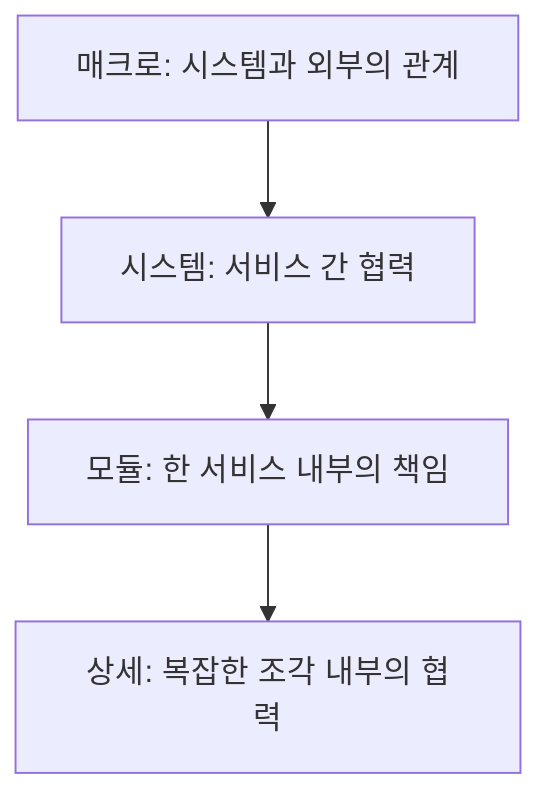

# 계층별 시스템 설계 방법론 Method-R

Method-R은 **시스템을 작은 조각으로 나누고, 복잡한 조각 안에서 같은 분할 규칙을 반복하는 방법론**이다. 목표는 조각마다 새로운 기법을 적용하는 것이 아니라, 같은 협력 원칙을 깊이만 달리해 적용하는 것이다.

> 각 조각은 자신의 책임과 도움을 요청할 시점에 집중한다. 형제 조각이 누구이며 어떻게 일하는지 몰라도 협력할 수 있도록 연결한다.

조각 사이의 연결은 상위 오케스트레이터 또는 공개 메시지 계약이 담당한다. 복잡한 조각을 확대하면 그 조각이 다음 계층의 조율자가 되고, 내부 조각들은 다시 자신의 책임에 집중한다.

분할·계약의 공통 기준은 [모듈 경계 가이드](module-boundary-guide.md), 조율자의 구현 책임은 [Orchestrator-Worker 가이드](orchestrator-worker-pattern-guide.md), 다이어그램 문법은 [Job Flow 가이드](job-flow-diagram-guide.md)를 따른다.

## 1. 네 가지 설계 깊이



이 그림은 확대 순서를 설명하는 보조 그림이다. 실제 시나리오는 `jobflow`로 작성한다.

| 깊이 | 핵심 질문 | 관찰 단위 | 협력 방식 |
|---|---|---|---|
| 매크로 | 시스템은 외부와 무엇을 주고받는가? | 시스템 하나와 사용자·외부 시스템·외부 조직 | 경계 메시지 |
| 시스템 | 어떤 서비스로 나누고 어떻게 연결하는가? | 서비스와 각 서비스의 공개 계약 | Orchestration 또는 Choreography |
| 모듈 | 한 서비스 안의 책임을 어떻게 나누는가? | 조율자·워커·게이트웨이·공용 기능 | 오케스트레이터–워커 협력 |
| 상세 | 복잡한 조각을 더 작은 책임으로 나눌 수 있는가? | 하위 조율자와 내부 조각 | 같은 협력 규칙의 재귀 적용 |

**상위의 객체 하나를 하위의 여러 조각으로 확대한다.** 상위가 사용하는 입력·결과·오류 계약은 유지하고, 그 계약을 구현하는 내부 협력을 보여 준다. 호출자가 상대의 내부 구성을 알아야만 사용할 수 있게 됐다면 경계를 다시 검토한다.

네 단계는 관찰 깊이다. 모든 시스템에 네 계층의 코드나 별도 서비스를 만들라는 뜻은 아니다. 같은 시스템에서도 부분마다 필요한 깊이가 다를 수 있다.

## 2. 조각의 협력과 서비스 간 통신

| 방식 | 연결 책임 | 각 조각이 아는 것 |
|---|---|---|
| 경계 메시지 | 시스템과 외부 사이의 공개 계약 | 요청·응답·알림과 필요한 데이터 |
| 내부 조율(Orchestration) | 상위 오케스트레이터 | 자신의 입력·결과·이벤트와 도움 요청 계약 |
| 독립 소비(Choreography) | 각 서비스의 발행·구독 계약 | 자신이 발행하거나 소비하는 메시지 |

매크로에서는 외부와의 논리적 입출력을 메시지로 표현한다. 시스템 수준에서는 전체 흐름을 한곳에서 조율할지, 서비스마다 메시지를 받아 독립적으로 처리할지 선택한다. 모듈·상세 수준에서는 상위가 내부 조각의 협력을 연결하는 규칙을 반복한다.

메시지는 메시지 큐만을 뜻하지 않는다. HTTP 요청·응답, 웹훅, 파일 교환 등도 경계에서 주고받는 계약이 될 수 있다. 실제 전송 방식과 다이어그램 표기는 구분한다.

### 2.1 상위 오케스트레이터가 도움 요청과 결과를 연결한다

오케스트레이터는 필요한 조각을 생성하거나 주입받아 연결한다. 워커는 자신의 처리와 도움 요청 계약만 알며 형제 워커를 찾아 호출하지 않는다. 구독·콜백의 연결과 해제는 오케스트레이터가 책임진다.

도움을 요청한 뒤 결과로 할 일이 없다면 다음처럼 표현한다.

```jobflow
orchestrator: Orchestrator
Object: Orchestrator, WorkerA, WorkerB
Orchestrator.ProcessRequest --> WorkerA.ProcessRequest
WorkerA.OnNeedHelp --> WorkerB.ProvideHelp
```

WorkerA가 요청을 알리면 Orchestrator가 WorkerB를 호출한다. WorkerA의 처리가 끝났다는 사실만으로 WorkerB의 작업까지 완료됐다고 판단하지 않는다.

반환값으로 자기 처리를 이어가야 한다면 응답자 하나인 요청 콜백을 사용한다.

```jobflow
orchestrator: Orchestrator
Object: Orchestrator, WorkerA, WorkerB
Orchestrator.ProcessRequest --> WorkerA.ProcessRequest
WorkerA.OnNeedHelp --> WorkerB.ProvideHelp
WorkerB.ProvideHelp --> WorkerA.OnNeedHelp.result
WorkerA.OnNeedHelp.result --> WorkerA.ContinueProcessing
```

Orchestrator는 WorkerB의 결과를 `OnNeedHelp`의 반환값으로 돌려준다. **그 값을 사용하는 주체는 WorkerA**다. `ContinueProcessing`은 실행 중인 `ProcessRequest`에서 응답을 받은 뒤 이어지는 내부 처리의 설명용 이름이다. Orchestrator가 호출하는 별도 공개 메서드나 `ProcessRequest`의 재호출이 아니다.

이벤트·콜백이라는 이유만으로 비동기 실행을 가정하지 않는다. 일반 알림 이벤트가 여러 구독자의 반환값을 자동으로 수집한다고 가정하지도 않는다. 반환·오류·응답자 수는 계약으로 정한다.

### 2.2 메시지를 알리고 각 수신자가 필요한 메시지에 반응한다

발행자는 메시지를 받을 객체의 목록과 내부 구현을 모른다. 구독자는 관심 있는 메시지를 받아 자기 처리를 수행한다. 하나의 메시지를 여러 서비스가 소비하더라도 각 서비스의 완료·실패는 별도로 판단한다.

상위 그림에서는 발행·전달·공개 수신 계약을 보이고, 수신자의 내부 그림에서는 이벤트를 독립 진입점으로 두어 처리 메서드에 연결한다. 메시지에서 이벤트로 들어오는 인과 화살표를 모두 그리지 않고, 대응 관계는 설명·계약에 적는다. 동기·비동기 여부와 관계없이 같은 표기를 사용한다.

같은 프로세스 안의 이벤트 버스도 사용할 수 있다. 다만 버스를 쓴다는 사실만으로 서비스들이 독립적으로 배포되거나 전체 조율자가 없어지는 것은 아니다.

### 2.3 독립 서비스가 REST API로 요청과 응답을 주고받는다

결과가 필요한 협력은 공개 API의 요청·응답으로 연결할 수 있다. 요청자는 상대의 주소·입력·결과·오류 계약을 알고, 상대의 내부 처리기는 몰라도 된다.

짧은 요청의 결과, 오래 걸리는 작업의 접수 응답, 나중에 도착하는 완료 알림을 구분한다. 접수는 업무 완료가 아니며, 결과 확인이 필요하면 상태 조회나 완료 알림의 책임을 정한다. 메시지 수신을 함수의 `.result`로 치환하지 않는다.

### 2.4 조율 방식과 전송 방식은 별도로 정한다

Orchestration은 **순서·분기·완료·복구를 한곳에서 조율하는 방식**, Choreography는 **각 소비자가 사건에 반응하고 전체 순서를 책임지는 단일 조율자가 없는 방식**이다.

서비스의 프로세스·배포 경계와 HTTP·메시지 브로커 같은 전송 수단은 별도로 선택한다. 독립 프로세스의 서비스도 오케스트레이터가 조율할 수 있고, 메시지 브로커를 사용하면서 중앙 조율자가 존재할 수도 있다. 내부 이벤트 역시 항상 비동기라는 뜻은 아니다.

## 3. 매크로 설계: 시스템을 하나의 경계로 보기

분석 대상 시스템을 하나의 객체로 놓고 사용자·외부 시스템·외부 조직과의 관계를 시나리오별로 표현한다. 이 단계의 시스템 객체는 관찰 경계이며, 내부 조율자를 선언하는 것이 아니다.

```jobflow
scope: 자료 변환 시스템과 외부의 협력
Object: User, ConversionSystem, ExternalArchive
User.OnConvertRequested --> ConversionSystem.message.ConvertRequest
ConversionSystem.message.ConvertRequest --> User.message.Accepted
ConversionSystem.OnCompleted --> ExternalArchive.message.ConvertedDocument
```

이 가상 예시에서 `Accepted`는 접수 응답이고, `OnCompleted`는 변환 완료 후의 별도 이벤트다. 내부 함수나 서비스 구성은 다음 단계에서 연다.

산출물에는 외부 참여자, 입력·결과·알림, 성공·실패·대기 조건을 남긴다. 모든 시나리오를 한 그림에 모으지 않는다.

## 4. 시스템 설계: 책임·상태 소유권과 협력

시스템 안을 책임이 다른 서비스로 나누고 각 서비스의 공개 계약과 데이터 소유자를 정한다. 서비스가 하나라면 서비스 간 협력 그림을 생략하고 그 서비스의 내부로 내려갈 수 있다.

### 4.1 Orchestration: 한곳에서 흐름을 조율한다

전체 작업의 순서·분기·완료·복구를 추적해야 한다면 조율자를 둔다. 참여 조각은 자기 작업의 결과나 이벤트를 제공하고, 다음 조각을 호출할지는 조율자가 결정한다.

```jobflow
orchestrator: ConversionFlow
Object: ConversionFlow, Reader, Converter, Writer
ConversionFlow.Run --> Reader.Read
Reader.Read --> Converter.Convert
Converter.Convert --> Writer.Save
Writer.Save --> ConversionFlow.Run.result
```

이 가상 예시에서는 ConversionFlow가 읽기·변환·저장의 결과를 연결하고 저장 결과를 호출자에게 반환한다. Reader·Converter·Writer가 서로의 다음 작업을 선택하지 않는다. 내부 작업이 반환값 대신 완료 이벤트를 제공한다면 실제 이벤트에서 다음 메서드로 연결한다.

### 4.2 Choreography: 각 서비스가 사건을 독립적으로 소비한다

한 서비스가 확정된 사실을 발행하면 다른 서비스가 자기 구독에 따라 처리한다. 발행자는 소비자의 목록이나 처리 순서를 결정하지 않는다.

```jobflow
scope: 변환 완료 알림 전달
Object: ConversionService, MessageBus, NotificationService
ConversionService.OnCompleted --> MessageBus.message.DocumentConverted
MessageBus.message.DocumentConverted --> NotificationService.message.DocumentConverted
```

MessageBus는 구독 계약에 따라 알림을 전달한다. NotificationService의 내부 처리 이벤트는 그 서비스의 내부 그림에서 시작한다. 다른 소비자가 추가돼도 발행 서비스가 그 소비자의 내부를 알아야 할 이유는 없다.

### 4.3 선택 결과 기록

| 판단할 것 | Orchestration을 검토할 경우 | Choreography를 검토할 경우 |
|---|---|---|
| 흐름 소유 | 한 유스케이스가 순서·완료·복구를 소유 | 각 소비자가 자기 완료 조건을 소유 |
| 결과 전달 | 앞 작업의 결과가 다음 작업의 입력 | 확정된 사실을 여러 소비자가 독립 처리 |
| 실패 대응 | 한곳에서 상태 조회·재시도·보상을 결정 | 소비자별 재처리·중복 방지·실패 관측을 구성 |
| 운영 비용 | 조율 상태와 집중된 책임 관리 | 메시지 계약·구독·전달 이력 관리 |

한 시스템 안에서 두 방식을 함께 사용할 수 있다. 동기·비동기 여부나 사용하는 제품 이름만으로 방식을 정하지 않는다. 보상이 필요하면 누가 언제 수행하는지 정하며, Saga를 모든 흐름에 의무적으로 도입하지 않는다.

## 5. 모듈 설계: 공개 계약 안을 확대하기

서비스 하나를 선택해 그 안의 책임을 나눈다. 상위에서 하나였던 서비스가 이 단계에서는 조율자와 여러 내부 조각으로 펼쳐진다.

| 역할 | 책임 |
|---|---|
| Main·오케스트레이터 | 흐름·결과·수명·오류 처리를 연결 |
| 워커 | 자신의 규칙과 상태를 처리하고 결과·이벤트 또는 도움 요청을 제공 |
| 게이트웨이 | DB·외부 API·파일·메시지 전달 같은 외부 접근을 감쌈 |
| 공용 기능 | 여러 조각이 사용하는 공통 기능을 명시적인 계약으로 제공 |

역할은 책임을 설명하는 기준이며 클래스·폴더를 각각 만들라는 규칙은 아니다. 내부 협력은 오케스트레이터–워커 규칙을 적용하고, 실제 계약에 맞게 이벤트·요청 콜백·호출과 반환을 사용한다. 반환값에 따른 분기는 `Object.Method.value`로 표현하며, 이를 위해 존재하지 않는 이벤트를 만들지 않는다.

형제 워커의 후속 작업을 직접 호출하는 대신 상위가 연결한다. 하위 함수나 명시적으로 주입된 포트를 사용하는 기준은 [Orchestrator-Worker 가이드](orchestrator-worker-pattern-guide.md#1-적용-범위)를 따른다.

## 6. 상세 설계: 불확실한 부분만 더 확대하기

한 워커가 여러 책임을 조율해야 할 만큼 복잡하다면, 그 워커를 하위 오케스트레이터로 두고 내부를 더 작은 조각으로 나눈다. **상위에서 보던 조각 하나에 같은 분할·연결 규칙을 다시 적용하는 것**이 재귀적 세분화다.

예를 들어 앞의 `Converter.Convert` 내부를 확대하면 다음과 같다.

```jobflow
orchestrator: Converter
Object: Converter, Normalizer, Encoder
Converter.Convert --> Normalizer.Normalize
Normalizer.Normalize --> Encoder.Encode
Encoder.Encode --> Converter.Convert.result
```

상위의 ConversionFlow는 계속 `Converter.Convert`만 사용한다. Normalizer와 Encoder의 구성·호출 순서는 Converter가 책임진다.

상위의 입력·결과·실패 의미는 유지한다. 하위 조율자는 자기 내부의 협력만 책임지며 상위 조율자가 하위 워커를 직접 제어하게 만들지 않는다. 공개 계약이 바뀌면 호출자·소비자에 미치는 영향을 함께 검토한다.

단순한 조건식이나 순차 처리를 설명하려고 하위 조율자·워커를 추가하지 않는다. 복잡한 상태 전이는 [State 가이드](state-diagram-guide.md), 내부 정책·구조는 [아키텍처 패턴 가이드](architecture-pattern-diagram-guide.md)에서 필요한 관점을 선택한다.

## 7. 흐름 밖에 필요한 계약

그림과 함께 다음 책임을 정한다. 상세 항목은 [모듈 계약 양식](module-boundary-guide.md#모듈-계약-양식)을 원본으로 사용한다.

- **데이터 소유권**: 규칙·상태·데이터를 누가 소유하고 쓰는가. 여러 조각이 같은 데이터를 직접 변경하는지 확인한다.
- **메시지 계약**: 생산자·소비자·데이터 형식·발행 시점·요청과 응답의 대응·전달 보장·중복 처리를 정한다.
- **실패 처리**: 오류·시간 초과·취소·결과 불명·재시도·보상과 복구 책임을 정한다. 접수와 업무 완료를 구분한다.

그림의 화살표만으로 원자성이나 전달 보장이 생기지는 않는다. 관련 기준은 [상태·실패·메시지의 소유권](module-boundary-guide.md#5-상태데이터와-실패의-소유권)을 따른다.

## 8. 검증과 분할 종료

분할 자체를 목표로 삼지 않는다. 각 부분의 책임·입출력·실패·검증 방법이 명확하고, 해당 작업을 판단하는 데 필요한 협력과 근거를 설명할 수 있으면 멈춘다. 멈추는 깊이는 부분마다 달라도 된다.

| 깊이 | 다음 확대 없이 설명할 수 있어야 하는 것 |
|---|---|
| 매크로 | 외부와의 입력·결과·성공 조건 |
| 시스템 | 서비스의 책임·소유권·공개 협력 |
| 모듈 | 워커의 역할과 조율자가 연결하는 흐름 |
| 상세 | 남은 정책·상태·실패 처리와 확인 근거 |

한 노드를 코드 한 줄에 대응시키거나 모든 부분을 같은 깊이까지 그릴 필요는 없다. 설계에서 새 조각을 만들지 않는 결정과, 기존 코드의 내부 협력을 분석하는 일은 구분한다. 내부 동작 분석의 완료는 [내부 추적 기준](system-design-document-guide.md#64-내부-추적과-완료-기준)을 따른다.

처음부터 전부 펼치지 않고, 상위 경계를 확인한 뒤 위험하거나 복잡한 조각부터 내려갈 수 있다. 탐색용 그림은 이해에 필요한 만큼 사용하고, 공유 설계 기준으로 남기는 문서는 코드·계약과 함께 갱신한다. Method-R은 분할과 협력의 골격을 정하는 방법이며 각 조각의 내부 구현에는 적합한 다른 설계 패턴을 적용할 수 있다.

분할 판단과 검증의 공통 기준은 [분할 중단 조건](module-boundary-guide.md#2-무엇을-한-조각으로-묶는가)과 [변경·검증 절차](module-boundary-guide.md#7-변경과-검증)를 따른다. 정적 문서 검토와 실제 코드 실행·렌더링 검증은 구분해 기록한다.
