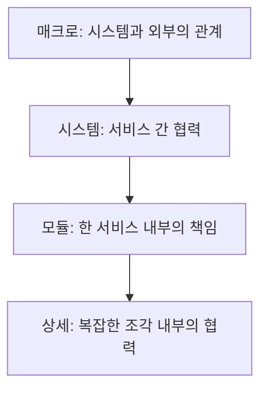

# 계층별 시스템 설계 방법론 Method-R

Method-R은 **업무상 중요한 사건을 중심으로 시스템을 이해하고, 복잡한 조각 안에서 같은 분할 규칙을 반복하는 방법론**이다. 분석할 사건을 먼저 고르고, 그 사건의 결과와 책임을 설명하는 데 필요한 협력을 깊이만 달리해 살핀다.

> 각 조각은 자신의 책임과 도움을 요청할 시점에 집중한다. 형제 조각이 누구이며 어떻게 일하는지 몰라도 협력할 수 있도록 연결한다.

조각 사이의 연결은 상위 오케스트레이터 또는 공개 메시지 계약이 담당한다. 복잡한 조각을 확대하면 그 조각이 다음 계층의 조율자가 되고, 내부 조각들은 다시 자신의 책임에 집중한다.

분할·계약의 공통 기준은 [모듈 경계 가이드](module-boundary-guide.md), 조율자의 구현 책임은 [Orchestrator-Worker 가이드](orchestrator-worker-pattern-guide.md), 다이어그램 문법은 [Job Flow 가이드](job-flow-diagram-guide.md)를 따른다.

Markdown 문서·다이어그램의 tools.camp 링크 생성 여부 확인과 전달은 [편집 링크 전달 기준](diagram-editor-link-guide.md)을 따른다.

## 1. 네 가지 설계 깊이



이 그림은 확대 순서를 설명하는 보조 그림이다. 분석 대상으로 고른 주요 흐름은 `jobflow`로 작성한다.

| 깊이 | 핵심 질문 | 관찰 단위 | 협력 방식 |
|---|---|---|---|
| 매크로 | 시스템은 외부와 무엇을 주고받는가? | 시스템 하나와 사용자·외부 시스템·외부 조직 | 경계 메시지와 업무 사건 |
| 시스템 | 어떤 서비스로 나누고 어떻게 연결하는가? | 서비스와 각 서비스의 공개 계약 | Orchestration 또는 Choreography |
| 모듈 | 한 서비스 안의 책임을 어떻게 나누는가? | 조율자·워커·게이트웨이·공용 기능 | 오케스트레이터–워커 협력 |
| 상세 | 복잡한 조각을 더 작은 책임으로 나눌 수 있는가? | 하위 조율자와 내부 조각 | 같은 협력 규칙의 재귀 적용 |

**상위의 객체 하나를 하위의 여러 조각으로 확대한다.** 상위가 사용하는 입력·결과·오류 계약은 유지하고, 그 계약을 구현하는 내부 협력을 보여 준다. 호출자가 상대의 내부 구성을 알아야만 사용할 수 있게 됐다면 경계를 다시 검토한다.

네 단계는 관찰 깊이다. 모든 시스템에 네 계층의 코드나 별도 서비스를 만들라는 뜻은 아니다. 같은 시스템에서도 부분마다 필요한 깊이가 다를 수 있다.

### 1.1 먼저 그릴 사건을 고른다

**모든 기능을 하나씩 그리지 않고, 분석과 설계 판단에 필요한 사건을 고른다.** 여기서 사건은 신청·승인·확정·취소처럼 업무에 의미가 있는 발생을 뜻한다. 함수 호출·동기 요청으로 처리해도 사건이며, 비동기 이벤트나 메시지 발행으로 구현할 필요는 없다.

| 그릴 가치가 있는 판단 | 확인할 내용 |
|---|---|
| 업무 결과·상태의 변화 | 무엇이 수락·거절·확정·취소되며 언제 완료되는가 |
| 책임·권한의 변화 | 누가 실행을 허가하고 상태를 소유하며 다음 처리를 맡는가 |
| 외부와의 협력 | 외부 승인·전달·인계를 언제 요청하고 어떤 결과를 확인하는가 |
| 실패·지연·결과 불명 | 부분 성공·중복·뒤늦은 알림에 누가 확인·재시도·보상을 맡는가 |
| 아직 풀리지 않은 의문 | 어떤 순서·조건·의존을 펼쳐 봐야 설계 결정을 내릴 수 있는가 |

단순 조회·저장처럼 요청과 결과만으로 의미가 충분한 기능은 설명이나 계약표로 남기고 독립 Job Flow를 생략할 수 있다. 반대로 연결이 짧아도 권한 판정·금전 처리·외부 부작용·완료의 불확실성을 판단해야 한다면 분석 대상으로 남긴다. 객체 수나 선 수만으로 중요도를 정하지 않는다.

같은 사건의 신청·응답·결과 확인·후속 처리는 한 흐름으로 묶는다. 각 요청·응답마다 별도 그림을 만들지 않으며, 관련 없는 사건까지 한 장에 모으지는 않는다. 문법 학습을 위한 작은 예시는 실무 분석 대상을 고르는 기준과 구분한다.

그림을 줄여도 분석 범위의 요구·실제 의존·중요한 실패 조건은 계약과 근거에서 확인할 수 있어야 한다. 그림 생략을 기능 제거·의존 감소·분석 완료의 근거로 삼지 않는다.

### 1.2 트리에 속하지 않는 횡단 공용 객체

Method-R의 분할은 트리다. 시스템을 서비스로, 서비스를 모듈로, 모듈의 조각을 상세로 나누며, 대부분의 조각은 자신을 만든 상위 조율자 하나에 속한다. 그런데 로거처럼 모듈에서도, 상세 조각에서도, 다른 서비스에서도 함께 쓰는 객체가 있다. 이런 객체는 트리의 한 노드에 넣으면 소속이 어긋나고, 노드마다 따로 만들면 같은 일이 중복된다.

이 문서는 이런 객체를 **횡단 공용 객체**(cross-cutting shared object)라고 부른다. 흔히 '글로벌 객체'라고도 하지만, 전역 변수·Singleton·전역 접근자로 꺼내 쓰는 방식과 혼동되므로 피한다. 횡단 공용 객체는 **여러 곳에서 쓰이는 역할**을 뜻하며, 어디서든 꺼내 쓸 수 있다는 접근 방식을 뜻하지 않는다.

| 예 | 제공하는 능력 |
|---|---|
| 로거·지표·추적 | 진단 기록과 관측 |
| 시계 | 현재 시각(테스트에서 고정할 수 있도록 주입) |
| 식별자 생성기 | 주문 ID·이벤트 ID 등 고유 값 |
| 설정·기능 플래그 읽기 | 실행 환경의 설정 값 |
| 직렬화·암호화·해시 | 형식 변환과 보안 연산 |

**판단 기준.** 아래를 모두 만족할 때 횡단 공용 객체로 둔다.

1. 서로 다른 깊이나 가지의 여러 조각이 같은 능력을 쓴다.
2. 업무 규칙을 판단하지 않는다. 능력만 제공하고, 그 값을 어떻게 쓸지는 사용하는 조각이 정한다.
3. 트리의 어떤 조각도 알지 못한다. 의존은 조각에서 횡단 공용 객체로 한 방향으로만 흐르고, 횡단 공용 객체가 조각을 호출하거나 조각의 이벤트를 구독하지 않는다.
4. 계약이 좁고 안정적이다. 사용처마다 기능을 덧붙여야 한다면 공용 객체가 아니라 그 조각의 책임이다.

**횡단 공용 객체가 아닌 것.** 형제 조각 사이에 업무 데이터나 작업을 전달하는 공유 캐시·공유 상태·내부 이벤트 버스는 조율자를 우회하는 숨은 협력 통로가 되므로 횡단 공용 객체로 두지 않는다. 그 데이터나 연결을 소유하는 조율자·조각에 둔다. 실패하면 업무도 실패해야 하는 기록(감사 기록 등)은 업무 의존이므로 게이트웨이로 다루고 흐름에 그린다. 한 서비스 안에서만 여러 조각이 함께 쓰는 기능은 [5장](#5-모듈-설계-공개-계약-안을-확대하기)의 공용 기능으로 그 서비스에 둔다.

**배치와 사용.**

- 트리 밖의 별도 층으로 보고, 인스턴스·수명·설정은 조립 진입점이 정해 필요한 조각에 주입한다. 전역 접근자나 Service Locator로 꺼내 쓰지 않는다([Orchestrator-Worker 가이드](orchestrator-worker-pattern-guide.md#2-구성-요소)).
- 요청 식별자 같은 실행 문맥은 전역 가변 상태에 두지 않고 명시적으로 전달한다. 진단 로그의 구조와 실패 정책은 [상세 로깅 가이드](detailed-logging-guide.md)를 따른다.
- 횡단 공용 객체가 실패해도 업무 흐름을 멈추지 않는 것이 기본이다. 멈춰야 한다면 위 기준에 따라 업무 의존으로 다시 분류한다.

**문서와 그림에서.**

- 횡단 공용 객체는 처음 필요해지는 가장 높은 설계 문서에 한 번 목록으로 적는다. 이름·제공 능력·계약·실패 정책·주입 위치를 남기고, 하위 문서는 그 목록을 참조한다.
- Job Flow 그림에는 로그 기록·지표 전송 같은 일상 호출을 그리지 않는다. 모든 조각에 같은 선이 붙어 협력 구조를 가린다. 그 결과가 흐름의 분기를 바꿀 때만 그린다. 시간에 따라 흐름이 시작되는 경우는 시계 호출보다 기한 도래 이벤트(`Scheduler.OnDeadline…`)로 그리는 편이 의도를 잘 드러낸다.

## 2. 조각의 협력과 서비스 간 통신

| 방식 | 연결 책임 | 각 조각이 아는 것 |
|---|---|---|
| 경계 메시지 | 시스템과 외부 사이의 공개 계약 | 요청·응답·알림과 필요한 데이터 |
| 내부 조율(Orchestration) | 상위 오케스트레이터 | 자신의 입력·결과·이벤트와 도움 요청 계약 |
| 독립 소비(Choreography) | 각 서비스의 발행·구독 계약 | 자신이 발행하거나 소비하는 메시지 |

매크로에서는 외부와 데이터로 주고받는 논리적 입출력을 메시지로 표현한다. 물건 등의 전달로 상대 객체에게 발생한 사건은 [실물 전달로 발생하는 이벤트](job-flow-diagram-guide.md#실물-전달로-발생하는-이벤트)로 구분한다. 시스템 수준에서는 전체 흐름을 한곳에서 조율할지, 서비스마다 메시지를 받아 독립적으로 처리할지 선택한다. 모듈·상세 수준에서는 상위가 내부 조각의 협력을 연결하는 규칙을 반복한다.

메시지는 메시지 큐만을 뜻하지 않는다. HTTP 요청·응답, 웹훅, 파일 교환 등도 경계에서 주고받는 계약이 될 수 있다. 실제 전송 방식과 다이어그램 표기는 구분한다.

### 2.1 상위 오케스트레이터가 도움 요청과 결과를 연결한다

오케스트레이터는 필요한 조각을 생성하거나 주입받아 연결한다. 워커는 자신의 처리와 도움 요청 계약만 알며 형제 워커를 찾아 호출하지 않는다. 구독·콜백의 연결과 해제는 오케스트레이터가 책임진다.

도움을 요청한 뒤 결과로 할 일이 없다면 다음처럼 표현한다.

```jobflow
orchestrator: Orchestrator
Object: Orchestrator, WorkerA, WorkerB
Orchestrator.ProcessRequest --> WorkerA.ProcessRequest
WorkerA.OnNeedHelp --> WorkerB.ProvideHelp
```

WorkerA가 요청을 알리면 Orchestrator가 WorkerB를 호출한다. WorkerA의 처리가 끝났다는 사실만으로 WorkerB의 작업까지 완료됐다고 판단하지 않는다.

반환값으로 자기 처리를 이어가야 한다면 응답자 하나인 요청 콜백을 사용한다.

```jobflow
orchestrator: Orchestrator
Object: Orchestrator, WorkerA, WorkerB
Orchestrator.ProcessRequest --> WorkerA.ProcessRequest
WorkerA.OnNeedHelp --> WorkerB.ProvideHelp
WorkerB.ProvideHelp --> WorkerA.OnNeedHelp.result
WorkerA.OnNeedHelp.result --> WorkerA.ContinueProcessing
```

Orchestrator는 WorkerB의 결과를 `OnNeedHelp`의 반환값으로 돌려준다. **그 값을 사용하는 주체는 WorkerA**다. `ContinueProcessing`은 실행 중인 `ProcessRequest`에서 응답을 받은 뒤 이어지는 내부 처리의 설명용 이름이다. Orchestrator가 호출하는 별도 공개 메서드나 `ProcessRequest`의 재호출이 아니다.

이벤트·콜백이라는 이유만으로 비동기 실행을 가정하지 않는다. 일반 알림 이벤트가 여러 구독자의 반환값을 자동으로 수집한다고 가정하지도 않는다. 반환·오류·응답자 수는 계약으로 정한다.

### 2.2 메시지를 알리고 각 수신자가 필요한 메시지에 반응한다

발행자는 메시지를 받을 객체의 목록과 내부 구현을 모른다. 구독자는 관심 있는 메시지를 받아 자기 처리를 수행한다. 하나의 메시지를 여러 서비스가 소비하더라도 각 서비스의 완료·실패는 별도로 판단한다.

상위 그림에서는 발행·전달·공개 수신 계약을 보이고, 수신자의 내부 그림에서는 이벤트를 독립 진입점으로 두어 처리 메서드에 연결한다. 메시지에서 이벤트로 들어오는 인과 화살표를 모두 그리지 않고, 대응 관계는 설명·계약에 적는다. 동기·비동기 여부와 관계없이 같은 표기를 사용한다.

같은 프로세스 안의 이벤트 버스도 사용할 수 있다. 다만 버스를 쓴다는 사실만으로 서비스들이 독립적으로 배포되거나 전체 조율자가 없어지는 것은 아니다.

### 2.3 독립 서비스가 REST API로 요청과 응답을 주고받는다

결과가 필요한 협력은 공개 API의 요청·응답으로 연결할 수 있다. 요청자는 상대의 주소·입력·결과·오류 계약을 알고, 상대의 내부 처리기는 몰라도 된다.

짧은 요청의 결과, 오래 걸리는 작업의 접수 응답, 나중에 도착하는 완료 알림을 구분한다. 접수는 업무 완료가 아니며, 결과 확인이 필요하면 상태 조회나 완료 알림의 책임을 정한다. 메시지 수신을 함수의 `.result`로 치환하지 않는다.

### 2.4 조율 방식과 전송 방식은 별도로 정한다

Orchestration은 **순서·분기·완료·복구를 한곳에서 조율하는 방식**, Choreography는 **각 소비자가 사건에 반응하고 전체 순서를 책임지는 단일 조율자가 없는 방식**이다.

서비스의 프로세스·배포 경계와 HTTP·메시지 브로커 같은 전송 수단은 별도로 선택한다. 독립 프로세스의 서비스도 오케스트레이터가 조율할 수 있고, 메시지 브로커를 사용하면서 중앙 조율자가 존재할 수도 있다. 내부 이벤트 역시 항상 비동기라는 뜻은 아니다.

### 2.5 처리 결과의 분기로 메시지를 보내는 이유를 드러낸다

매크로뷰와 서비스 간 협력 그림은 **메시지를 받은 객체가 어떤 판단을 하고, 어떤 결과 때문에 누구에게 어떤 메시지를 보내는지** 보여 준다. 메시지만 나열하면 왜 그 메시지가 전달되는지 읽을 수 없으므로, 판단과 결과를 그림에 둔다. 이 절의 규칙은 `scope:`를 쓰는 매크로뷰와 서비스 간 협력 그림에 적용하고, 모듈·상세 그림은 [5장](#5-모듈-설계-공개-계약-안을-확대하기)과 [Job Flow 내부 확대](job-flow-diagram-guide.md#내부-확대)를 따른다.

| 메시지를 받은 뒤 | 그림 표기 |
|---|---|
| 판단 결과에 따라 보내는 메시지가 달라진다 | `객체.message.수신메시지 --> 객체.처리명`, 결과마다 `객체.처리명.결과 --> 상대.message.메시지` |
| 조건부 판단의 한 결과만 그림의 다른 객체로 이어지고 나머지 결과는 객체 안에서 끝난다 | 남는 결과 하나도 `객체.처리명.결과`로 표시한다. 그 결과가 메시지를 보내는 이유다 |
| 조건 없이 다음 메시지를 보낸다 | 처리를 그리지 않고 `객체.message.수신메시지 --> 상대.message.메시지`로 바로 잇는다 |
| 그림의 다른 객체에 메시지를 보내지 않고 끝난다 | 처리와 그 결과를 그리지 않는다. 기록·보관·폐기 등은 그림 아래 설명에 남긴다 |

- **그림의 다른 객체**는 그 그림의 `Object:`에 선언한 객체다. 매크로뷰에서는 사용자·외부 조직·외부 시스템, 서비스 간 협력 그림에서는 다른 서비스다. 선언하지 않은 화면·저장소로 가는 응답은 객체 안에서 끝나는 처리로 본다.
- **결과 이름은 메시지를 보내는 이유로 짓는다.** `유효한신청`·`겹치는예약있음`·`새신청`처럼 다음 메시지가 왜 나가는지 읽히게 하고, `성공`·`실패`·`완료`·`기록됨`처럼 상태만 말하는 이름으로 이유가 드러나지 않으면 업무 조건을 적는다. 결과를 알 수 없어 확인 대기를 알리는 경우는 `확인중`처럼 그 사실을 이름으로 쓴다.
- **같은 메시지로 가는 결과는 하나로 묶는다.** 수신자가 사유에 따라 다르게 처리해야 하면 메시지를 나누거나, 메시지에 담는 사유를 그림 아래 설명에 적는다.
- **이름만 있는 전달 단계는 그리지 않는다.** `요청전달`·`저장후발송`·`거절처리`처럼 판단 없이 다음 메시지를 보내는 노드를 메시지 사이에 끼우면 어느 것이 분기인지 읽기 어렵다.
- **한 결과가 여러 메시지를 보내는 것은 분기가 아니다.** 같은 결과에서 각 메시지로 선을 잇는다.
- **한 수신 메시지에서 조건 없는 메시지와 조건부 메시지가 함께 나가면** 조건 없는 메시지는 수신 노드에서 바로 잇고, 조건부 메시지만 처리와 결과를 거친다. 조건 없는 메시지를 처리의 모든 결과에 반복하지 않는다.
- **판단으로 보는 것과 보지 않는 것.** 업무 상태(신청 가능 여부·소유권·기한 등), 수신 메시지의 종류 값(취소·반품·교환 등), 같은 사실의 처음 반영 여부(중복·역순 도착을 한 번만 반영)에 따라 보낼 메시지가 달라지면 판단이다. 형식 오류·서명 검증·전송 중복 제거처럼 모든 수신에 공통인 방어는 판단으로 그리지 않고 [메시지 계약](#7-흐름-밖에-필요한-계약)에 적는다.
- **판단의 주인은 메시지를 받은 객체다.** 응답 메시지는 요청한 객체의 수신 계약이며, 원격 판단의 결과를 요청자의 `.result`로 표현하지 않는다. `처리명.결과` 표기는 [Job Flow의 반환값 분기](job-flow-diagram-guide.md#메서드-반환값에-따른-분기) 표기를 수신 객체의 판단에 적용한 것이다.
- **외부 객체와 그림에 선언하지 않은 제공자의 판단은 열지 않는다.** 매크로뷰의 외부 조직·외부 시스템은 받은 요청의 결과를 하나의 응답·알림 메시지로 돌려주고, 그 결과에 따른 갈림은 그것을 받은 객체의 판단으로 그린다.
- **그림에 선언하지 않은 제공자와의 교환.** 수신 처리 도중 그 제공자를 호출하고 응답으로 판단하면 제공자 호출은 그리지 않고 수신 메시지의 처리 결과로 그린다. 제공자가 나중에 따로 보내는 통지는 받는 객체의 이벤트(`객체.On…제공자통지`)로 시작하며, 이름은 제공자가 보낸 원래 통지 하나로 짓는다. 받는 객체의 검증·분류 결과(`검증됨`·`접수됨` 등)를 수신 메시지 이름에 미리 넣지 않고 처리와 결과로 그린다.
- 서비스 간 협력 그림에서 객체가 자기 일정(기한 도래·재확인 시점)으로 시작하는 흐름은 `객체.On재확인시점` 같은 이벤트로 시작하고 같은 규칙을 따른다. 판단이 있으면 처리를 두고, 없으면 이벤트에서 보낼 메시지로 바로 잇는다. 매크로뷰는 [3.2](#32-한글-명칭과-문법)를 따른다.
- **같은 이름의 처리는 모든 그림에서 같은 판단이며 같은 결과 이름을 쓴다.** 여러 그림이 한 판단을 공유하면 그림마다 그 시나리오의 결과만 표시한다. 같은 응답 메시지라도 요청한 맥락(진행 중인 업무)에 따라 보낼 메시지가 달라지면, 그 맥락을 결과로 갖는 처리를 받는 객체에 둔다.
- 상위 그림의 `객체.처리명`은 수신 계약 수준의 판단 이름이다. 그 객체의 모듈 그림은 [2.2](#22-메시지를-알리고-각-수신자가-필요한-메시지에-반응한다)대로 이벤트·메서드를 독립 진입점으로 시작하며, 상위 처리명·결과와 하위 진입점·반환값의 대응은 설명이나 계약에 적는다.
- **흐름의 마무리를 확인한다.** 외부 통지나 응답으로 업무 결과(완료·최종 실패·거절)가 확정되면, 그 결과를 기다리는 그림의 객체(신청한 사용자 등)에게 알리는 메시지까지 그린다. 진행 상태만 바뀌는 통지(배송 중·처리 중)는 알림 없이 상태 조회로 제공한다고 설명에 적는다. 수신 메시지로 끝나는 노드마다 그 뒤에 누가 결과를 알아야 하는지 확인한다.
  - 외부의 접수 응답은 최종 결과가 아니다. 접수 뒤 실제 결과를 확인하는 조회·통지와 그 판단까지 이어 그리고, 접수 거절·결과 불명은 같은 키로 다시 요청한다고 설명에 적는다.
  - `확인중`으로 응답한 뒤 나중에 결과가 확정되면 같은 판단을 거쳐 최종 결과를 알린다. 열린 요청이 없으면 결과를 기다리는 객체에게 별도 안내로 보낸다.
  - 최종 실패는 운영 확인 등 종결 책임자에게 넘기는 결과와 신청자에게 보내는 안내까지 그린다. 그림 밖 담당자의 처리 이후 결과를 어떻게 확인해 알리는지도 설명에 적는다.
  - 서비스 간 협력 그림에서는 화면·사용자가 객체가 아니므로, 비동기로 확정된 결과를 사용자에게 알리는 서비스를 설명에 적고 매크로뷰의 안내와 대응시킨다.
- 지운 처리가 있으면 수신 메시지 노드는 수신 계약이므로 남기고, 지운 결과의 조건·실패·대기 의미가 그림 아래 설명에 남는지 확인한다.
- 줄 순서는 [선 교차 줄이기](job-flow-diagram-guide.md#선-교차-줄이기)를 따른다. 호출 줄 바로 뒤에 그 처리의 결과 분기를 붙이고, 여러 곳에서 모이는 공유 종결로 가는 분기는 맨 아래로 모은다.

## 3. 매크로 설계: 시스템을 하나의 경계로 보기

매크로뷰는 **업무 대상 시스템 하나와 그 시스템에 영향을 주거나 결과를 받는 외부 객체의 관계**를 보여 준다. 대상 시스템의 관찰 경계를 먼저 적고, 구현 방식과 관계없이 그 시스템 전체를 하나의 객체로 표현한다. 마이크로서비스가 여러 개이거나 화면·서버가 나뉘어 있어도 매크로뷰에서 대상 시스템을 여러 내부 객체로 나누지 않는다.

### 3.1 시스템과 외부 객체의 경계

- 대상 시스템에 포함한 UI·내부 서비스·DB·조율자는 시스템 객체 안에 둔다. 내부 타이머·재시도 스케줄러와 저장·복구 처리 순서도 매크로뷰에 노출하지 않는다. 이 협력이 필요하면 다음 설계 깊이에서 연다. 다만 외부에 어떤 메시지를 보낼지 정하는 시스템의 판단은 [처리 결과 분기](#25-처리-결과의-분기로-메시지를-보내는-이유를-드러낸다)로 표시한다.
- 외부 객체는 관찰 경계 밖에서 시스템과 업무를 주고받는 사용자·운영 역할·조직·다른 시스템이다. 사용자, 관리자, 협력 기관, 외부 제공자 등의 역할은 실제 대상 범위에 있는 것만 고른다. 예시에 등장했다는 이유로 객체나 기능을 추가하지 않는다.
- 외부 여부는 회사 소속이나 실행 프로세스의 차이만으로 정하지 않는다. 같은 조직의 관리자도 시스템을 사용하는 사람이면 외부 객체가 될 수 있고, 별도 프로세스로 실행되는 내부 서비스도 대상 시스템에 포함되면 매크로뷰에서 따로 그리지 않는다.
- 시스템과 외부 사이에서 데이터로 주고받는 요청·접수·결과·알림을 업무별 메시지로 연결한다. 실물 전달로 상대 객체에게 발생한 사건은 [수신 객체의 이벤트](job-flow-diagram-guide.md#실물-전달로-발생하는-이벤트)로 표현하며, 이를 시스템에 기록·통지하는 데이터 흐름과 구분한다. `요청`·`결과`처럼 업무를 드러내지 않고 여러 업무를 묶는 포괄 메시지로 전체 관계를 대신하지 않는다. 전체 관계의 요약이 필요하면 외부 객체별로 주고받는 메시지를 표로 정리한다. 외부 객체끼리의 상호작용도 해당 시나리오의 설명 범위에 포함될 때 필요한 만큼 표시한다. 접수와 업무 완료, 요청과 독립 알림은 구분한다.

### 3.2 한글 명칭과 문법

매크로뷰와 서비스 간 협력 그림의 객체명·처리명·결과·메시지명은 업무 의미가 드러나는 한글로 작성한다. `scope:`, `Object:`, `message`, `orchestrator:`, `result`, `On` 등 DSL 문법 키워드는 그대로 유지한다. 모듈·상세뷰는 실제 구현 심볼을 사용할 수 있으며, 서비스 목록에 한글 서비스명과 구현 이름의 대응을 적는다.

`scope:`에는 관찰 대상과 시나리오를 적는다. 시스템 객체는 업무 대상을 나타내며, 내부 조율자를 선언하기 위해 `orchestrator:`로 바꾸지 않는다. 메시지 이름은 그 메시지만 보고 어떤 업무인지 알 수 있게 짓는다. 외부 객체에서 시작되는 행동과 독립 통지는 처리가 아니라 `외부객체.On행동` 이벤트로 쓴다(`이용자.On대관예약신청`, `시설운영자.On이용제한통지`). 시스템 객체는 받은 메시지에서 시작하며, 시스템 안의 타이머·재처리 진입은 매크로뷰에 이벤트로 노출하지 않는다. 시스템 안의 업무 기한이 지나 외부에 메시지를 보내야 하면 `예약시스템.확인기한경과`처럼 업무 시점을 이름으로 하는 판단에서 시작한다. 시스템의 판단과 결과(`예약시스템.신청검사.입력오류`)도 한글로 쓰며, 결과에 따라 보내는 메시지가 달라지는 판단은 그림에 표시하고 매개변수·세부 조건·실패·대기의 의미는 그림 밖에서 설명한다.

### 3.3 가상 예시: 대관 예약

아래는 대관 예약 시스템과 이용자·시설 운영자의 관계를 설명하는 가상 예시다. 시설 운영자는 시스템과 대관 가능 여부·이용 제한을 주고받는 외부 업무 역할이다.

```jobflow
scope: 대관 예약 시스템과 외부의 협력
Object: 이용자, 예약시스템, 시설운영자
이용자.On대관예약신청 --> 예약시스템.message.대관예약요청
예약시스템.message.대관예약요청 --> 예약시스템.신청검사
예약시스템.신청검사.유효한신청 --> 시설운영자.message.대관가능여부확인요청
예약시스템.신청검사.유효한신청 --> 이용자.message.예약확인대기안내
예약시스템.신청검사.입력오류 --> 이용자.message.예약신청거절
시설운영자.message.대관가능여부확인요청 --> 예약시스템.message.대관가능여부회신
예약시스템.message.대관가능여부회신 --> 예약시스템.예약확정판정
예약시스템.예약확정판정.운영자승인 --> 이용자.message.예약확정안내
예약시스템.예약확정판정.운영자거절 --> 이용자.message.예약불가안내
시설운영자.On이용제한통지 --> 예약시스템.message.시설이용제한알림
예약시스템.message.시설이용제한알림 --> 예약시스템.영향예약확인
예약시스템.영향예약확인.겹치는예약있음 --> 이용자.message.예약변경안내
```

- `신청검사`는 날짜·인원·이용 목적을 검사한다. 유효한 신청은 운영자에게 확인을 요청하는 동시에 이용자에게 확인 대기를 알리고, 입력 오류는 바로 거절 사유를 돌려준다.
- 운영자의 회신은 하나의 메시지이며, 승인·거절은 그것을 받은 예약시스템의 `예약확정판정`에서 갈린다. 회신이 오지 않는 동안의 재요청이나 기한 경과 처리는 별도 사건으로 다른 그림에서 다룬다.
- `시설이용제한알림`은 앞선 예약 요청의 응답이 아니라 시설 운영자가 독립적으로 보내는 알림이다. 제한 기간과 겹치는 예약이 없으면 시스템 안에서 기록만 하므로, 그림에는 이용자에게 안내를 보내는 이유인 `겹치는예약있음`만 남는다.

산출물에는 선택한 주요 사건에 대해 시스템의 관찰 경계, 외부 객체의 역할, 요청·결과·알림과 성공·실패·대기 조건을 남긴다. 사건의 시작부터 결과 확인과 필요한 후속 처리까지 함께 읽히도록 묶고, 서로 다른 판단이 섞여 복잡해지면 같은 시스템 경계를 유지한 채 나눈다. 단순한 기능 목록을 채우기 위한 그림은 만들지 않는다.

## 4. 시스템 설계: 책임·상태 소유권과 협력

시스템 안을 책임이 다른 서비스로 나누고 각 서비스의 공개 계약과 데이터 소유자를 정한다. 서비스가 하나라면 서비스 간 협력 그림을 생략하고 그 서비스의 내부로 내려갈 수 있다. 서비스로 나누는 것은 책임과 상태 소유를 드러내는 설계 관점이며, 배포 단위를 반드시 나누라는 뜻은 아니다. 규모가 작거나 한 팀이 함께 배포하고 강한 일관성이 중요한 시스템에서는 같은 책임 경계를 모듈로 유지한 모놀리스가 운영 비용과 장애 지점을 줄여 더 나을 수 있다. 분산 배포는 독립 배포·확장·장애 격리의 필요가 서비스 간 통신·결과 불명·보상의 비용보다 클 때 선택한다.

### 4.1 Orchestration: 한곳에서 흐름을 조율한다

전체 작업의 순서·분기·완료·복구를 추적해야 한다면 조율자를 둔다. 참여 조각은 자기 작업의 결과나 이벤트를 제공하고, 다음 조각을 호출할지는 조율자가 결정한다.

```jobflow
orchestrator: ConversionFlow
Object: ConversionFlow, Reader, Converter, Writer
ConversionFlow.Run --> Reader.Read
Reader.Read --> Converter.Convert
Converter.Convert --> Writer.Save
Writer.Save --> ConversionFlow.Run.result
```

이 가상 예시에서는 ConversionFlow가 읽기·변환·저장의 결과를 연결하고 저장 결과를 호출자에게 반환한다. Reader·Converter·Writer가 서로의 다음 작업을 선택하지 않는다. 내부 작업이 반환값 대신 완료 이벤트를 제공한다면 실제 이벤트에서 다음 메서드로 연결한다.

### 4.2 Choreography: 각 서비스가 사건을 독립적으로 소비한다

한 서비스가 확정된 사실을 발행하면 다른 서비스가 자기 구독에 따라 처리한다. 발행자는 소비자의 목록이나 처리 순서를 결정하지 않는다.

```jobflow
scope: 변환 완료 알림 전달
Object: 변환, 메시지버스, 알림
변환.On변환완료 --> 메시지버스.message.문서변환완료
메시지버스.message.문서변환완료 --> 알림.message.문서변환완료
```

메시지버스는 구독 계약에 따라 알림을 전달한다. 알림 서비스의 내부 처리 이벤트는 그 서비스의 내부 그림에서 시작한다. 다른 소비자가 추가돼도 발행 서비스가 그 소비자의 내부를 알아야 할 이유는 없다.

### 4.3 선택 결과 기록

| 판단할 것 | Orchestration을 검토할 경우 | Choreography를 검토할 경우 |
|---|---|---|
| 흐름 소유 | 한 유스케이스가 순서·완료·복구를 소유 | 각 소비자가 자기 완료 조건을 소유 |
| 결과 전달 | 앞 작업의 결과가 다음 작업의 입력 | 확정된 사실을 여러 소비자가 독립 처리 |
| 실패 대응 | 한곳에서 상태 조회·재시도·보상을 결정 | 소비자별 재처리·중복 방지·실패 관측을 구성 |
| 운영 비용 | 조율 상태와 집중된 책임 관리 | 메시지 계약·구독·전달 이력 관리 |

한 시스템 안에서 두 방식을 함께 사용할 수 있다. 동기·비동기 여부나 사용하는 제품 이름만으로 방식을 정하지 않는다. 보상이 필요하면 누가 언제 수행하는지 정하며, Saga를 모든 흐름에 의무적으로 도입하지 않는다.

### 4.4 서비스 간 협력 그림: 수신 처리와 결과 분기

서비스 간 협력 그림도 [처리 결과 분기](#25-처리-결과의-분기로-메시지를-보내는-이유를-드러낸다) 규칙으로 그린다. 그림의 객체는 서비스다. 화면(사용자)의 요청과 그림에 선언하지 않은 외부 제공자의 통지는 보낸 쪽이 그림에 없는 독립 진입점이므로, 받는 서비스의 이벤트 `서비스.On요청명`으로 시작하고 이름은 받는 공개 계약의 이름을 그대로 쓴다. 서비스 사이의 요청·응답·알림은 `서비스.message.메시지명`으로 그리며, 다른 그림의 서비스가 보낸 메시지에서 이어지는 그림은 message로 시작한다. 화면 UI는 객체로 선언하지 않으므로 화면에만 돌려주는 응답·거절·대기 안내는 서비스 안에서 끝나는 처리로 보고 그림 아래 설명에 적는다. 판단 과정의 내부 구성은 모듈 설계에서 연다.

아래는 서비스 간 협력을 그린 가상 예시다. 3.3과 별개로, 운영자 확인 없이 시설을 즉시 확보하고 보증금을 청구하는 대관 서비스를 가정한다.

```jobflow
scope: 대관 신청의 시설 확보와 보증금 청구
Object: 시설, 예약, 청구
예약.On예약신청요청 --> 예약.예약신청검사
예약.예약신청검사.새신청 --> 시설.message.시설확보요청
시설.message.시설확보요청 --> 시설.시설확보
시설.시설확보.확보됨 --> 예약.message.시설확보됨
시설.시설확보.이용불가 --> 예약.message.시설이용불가
예약.message.시설확보됨 --> 청구.message.보증금청구요청
청구.message.보증금청구요청 --> 청구.보증금청구
청구.보증금청구.청구완료 --> 예약.message.보증금청구완료
청구.보증금청구.결제거절 --> 예약.message.보증금결제거절
예약.message.보증금청구완료 --> 시설.message.확보확정요청
예약.message.보증금결제거절 --> 시설.message.확보해제요청
```

- `예약.예약신청검사`는 입력 오류·중복 신청이면 화면에 결과를 돌려주고 끝난다. 새 신청이라는 결과가 시설 확보를 요청하는 이유이므로, 그림에 남는 결과가 `새신청` 하나여도 표시한다.
- `이용불가`는 사용 중·점검 중을 함께 뜻하며, 사유는 `시설이용불가`에 담는다. 같은 메시지로 가므로 결과를 나누지 않는다.
- `시설확보됨`을 받으면 조건 없이 보증금을 청구하므로 처리 없이 바로 잇는다. 청구 결과에 따라 확보를 확정하거나 해제하는 요청도 조건 없이 이어진다. 화면 응답과 예약 상태 저장은 예약 서비스 안에서 끝나므로 그리지 않으며, 예약 확정·실패 안내는 예약 서비스가 이용자에게 보낸다.
- 청구 결과를 바로 알 수 없으면 청구 서비스가 결과가 확인될 때까지 청구를 보류하고, 확인된 뒤 같은 `청구완료`·`결제거절` 결과로 알린다. `확보확정요청`·`확보해제요청`을 받은 시설 서비스는 상태를 바꾸고 끝나며, 실패 시 재시도는 시설 서비스가 맡는다.

## 5. 모듈 설계: 공개 계약 안을 확대하기

서비스 하나를 선택해 그 안의 책임을 나눈다. 상위에서 하나였던 서비스가 이 단계에서는 조율자와 여러 내부 조각으로 펼쳐진다.

| 역할 | 책임 |
|---|---|
| Main·오케스트레이터 | 흐름·결과·수명·오류 처리를 연결 |
| 워커 | 자신의 규칙과 상태를 처리하고 결과·이벤트 또는 도움 요청을 제공 |
| 게이트웨이 | DB·외부 API·파일·메시지 전달 같은 외부 접근을 감쌈 |
| 공용 기능 | 이 서비스 안의 여러 조각이 사용하는 공통 기능을 명시적인 계약으로 제공. 여러 깊이·서비스에 걸쳐 쓰이는 로거·시계 등은 [횡단 공용 객체](#12-트리에-속하지-않는-횡단-공용-객체)로 트리 밖에 둔다 |

역할은 책임을 설명하는 기준이며 클래스·폴더를 각각 만들라는 규칙은 아니다. 내부 협력은 오케스트레이터–워커 규칙을 적용하고, 실제 계약에 맞게 이벤트·요청 콜백·호출과 반환을 사용한다. 반환값에 따른 분기는 `Object.Method.value`로 표현하며, 이를 위해 존재하지 않는 이벤트를 만들지 않는다.

형제 워커의 후속 작업을 직접 호출하는 대신 상위가 연결한다.

모듈 그림을 그릴 때 다음을 확인한다.

- **호출과 이벤트를 구분한다.** 호출자가 결과를 기다리고 반환값이 다음 판단을 정하면 메서드 호출과 반환값 분기로 그린다. 메시지 수신·기한 도래·기록 커밋처럼 기다리는 호출자가 없는 입력은 그 입력이 생긴 객체의 `On…` 이벤트로 그리고 조율자가 구독한다([Job Flow 가이드의 VideoPlayer 예시](job-flow-diagram-guide.md#다이어그램-예제)). 주기 실행으로만 처리하던 후속 작업(전달·해제 등)은 커밋 뒤 이벤트로 바로 처리하고, 놓친 이벤트와 재시도만 주기 확인에 맡긴다. 상태 저장과 묶인 이벤트는 커밋 뒤에 낸다.
- **진입점마다 응답을 따로 그린다.** 한 조율자가 여러 공개 요청을 받으면 진입 메서드별로 그림을 나누고, 각 경로는 그 진입점의 `.result`로만 돌아간다. 다른 진입점의 `.result`를 공용 반환처럼 쓰지 않는다. 상태를 만들지 않는 읽기 판정과 상태를 만드는 요청은 변경 이유가 다르면 조율자를 나눈다.
- **규칙은 워커, 저장과 외부 호출은 게이트웨이가 맡는다.** 저장 메서드는 워커가 계산한 다음 상태를 저장할 뿐 업무 판단 결과를 다시 돌려주지 않는다. 게이트웨이는 업무 거절과 시간 초과·결과 불명을 다른 결과로 돌려준다.
- **경합과 재시도의 끝을 보인다.** 조건부 저장이 충돌하면 진입점이 아니라 다시 읽는 단계로 되돌리고, 재시도 횟수와 한도 초과 시 응답을 설명에 적는다. 외부 효과를 일으키기 전에 다른 흐름과 겹칠 수 있는 상태(확정 진행 중 등)를 먼저 저장한다.
- **상태와 후속 작업을 한 트랜잭션으로 남긴다.** 다른 서비스로 보낼 메시지·사용자 안내·나중에 실행할 작업(예약 해제 등)은 상태 변경과 같은 트랜잭션에 기록하고 별도 전달·실행 흐름이 처리한다. 받은 알림의 처리 기록도 상태 반영과 같은 트랜잭션에 남겨, 반영이 실패하면 재전달로 다시 처리되게 한다.
- **응답 불명과 저장 실패 뒤 재시도 경로를 그린다.** 같은 요청 키의 재시도가 대기 중인 요청을 어디서부터 다시 확인하는지, 저장되지 않은 결과의 외부 효과(확보한 예약 등)를 누가 정리하는지 보인다. 하위 함수나 명시적으로 주입된 포트를 사용하는 기준은 [Orchestrator-Worker 가이드](orchestrator-worker-pattern-guide.md#1-적용-범위)를 따른다.

## 6. 상세 설계: 불확실한 부분만 더 확대하기

한 워커가 여러 책임을 조율해야 할 만큼 복잡하다면, 그 워커를 하위 오케스트레이터로 두고 내부를 더 작은 조각으로 나눈다. **상위에서 보던 조각 하나에 같은 분할·연결 규칙을 다시 적용하는 것**이 재귀적 세분화다.

예를 들어 앞의 `Converter.Convert` 내부를 확대하면 다음과 같다.

```jobflow
orchestrator: Converter
Object: Converter, Normalizer, Encoder
Converter.Convert --> Normalizer.Normalize
Normalizer.Normalize --> Encoder.Encode
Encoder.Encode --> Converter.Convert.result
```

상위의 ConversionFlow는 계속 `Converter.Convert`만 사용한다. Normalizer와 Encoder의 구성·호출 순서는 Converter가 책임진다.

상위의 입력·결과·실패 의미는 유지한다. 하위 조율자는 자기 내부의 협력만 책임지며 상위 조율자가 하위 워커를 직접 제어하게 만들지 않는다. 공개 계약이 바뀌면 호출자·소비자에 미치는 영향을 함께 검토한다.

단순한 조건식이나 순차 처리를 설명하려고 하위 조율자·워커를 추가하지 않는다. 복잡한 상태 전이는 [State 가이드](state-diagram-guide.md), 내부 정책·구조는 [아키텍처 패턴 가이드](architecture-pattern-diagram-guide.md)에서 필요한 관점을 선택한다.

## 7. 흐름 밖에 필요한 계약

그림과 함께 다음 책임을 정한다. 상세 항목은 [모듈 계약 양식](module-boundary-guide.md#모듈-계약-양식)을 원본으로 사용한다.

- **데이터 소유권**: 규칙·상태·데이터를 누가 소유하고 쓰는가. 여러 조각이 같은 데이터를 직접 변경하는지 확인한다.
- **메시지 계약**: 생산자·소비자·데이터 형식·발행 시점·요청과 응답의 대응·전달 보장·중복 처리를 정한다.
- **실패 처리**: 오류·시간 초과·취소·결과 불명·재시도·보상과 복구 책임을 정한다. 접수와 업무 완료를 구분한다.

그림의 화살표만으로 원자성이나 전달 보장이 생기지는 않는다. 관련 기준은 [상태·실패·메시지의 소유권](module-boundary-guide.md#5-상태데이터와-실패의-소유권)을 따른다.

## 8. 검증과 분할 종료

분할 자체를 목표로 삼지 않는다. 선택한 사건의 결과·책임·중요한 실패와 남은 의문을 설명할 수 있고, 더 그려도 새로운 판단에 도움이 되지 않으면 멈춘다. 각 부분의 입출력·검증 방법과 근거는 확인할 수 있어야 하며, 멈추는 깊이는 부분마다 달라도 된다.

| 깊이 | 다음 확대 없이 설명할 수 있어야 하는 것 |
|---|---|
| 매크로 | 외부와의 입력·결과·성공 조건 |
| 시스템 | 서비스의 책임·소유권·공개 협력 |
| 모듈 | 워커의 역할과 조율자가 연결하는 흐름 |
| 상세 | 남은 정책·상태·실패 처리와 확인 근거 |

한 노드를 코드 한 줄에 대응시키거나 모든 부분을 같은 깊이까지 그릴 필요는 없다. 설계에서 새 조각을 만들지 않는 결정과, 기존 코드의 내부 협력을 분석하는 일은 구분한다. 내부 동작 분석의 완료는 [내부 추적 기준](system-design-document-guide.md#64-내부-추적과-완료-기준)을 따른다.

처음부터 전부 펼치지 않고, 상위 경계를 확인한 뒤 위험하거나 복잡한 조각부터 내려갈 수 있다. 탐색용 그림은 이해에 필요한 만큼 사용하고, 공유 설계 기준으로 남기는 문서는 코드·계약과 함께 갱신한다. Method-R은 분할과 협력의 골격을 정하는 방법이며 각 조각의 내부 구현에는 적합한 다른 설계 패턴을 적용할 수 있다.

분할 판단과 검증의 공통 기준은 [분할 중단 조건](module-boundary-guide.md#2-무엇을-한-조각으로-묶는가)과 [변경·검증 절차](module-boundary-guide.md#7-변경과-검증)를 따른다. 정적 문서 검토와 실제 코드 실행·렌더링 검증은 구분해 기록한다.
